# Lab 01 — Contract-First Orders API

In this lab, you will build a small Orders REST API using Node.js, Express, and OpenAPI 3.0.3.

You will first describe how the API should work in an `openapi.yaml` file. That file is the API contract: it documents the endpoints, required headers, request data, response data, and error formats. Then you will write a small Express server that follows the important rules in the contract.

By the end of this lab, you will be able to:

- Create an order with `POST /api/v1/orders`.
- Retrieve one order with `GET /api/v1/orders/{id}`.
- List orders in pages with `GET /api/v1/orders`.
- Return errors in the RFC 7807 Problem Details format.
- Run the service locally and expose it through the Poridhi Load Balancer on port 5000.

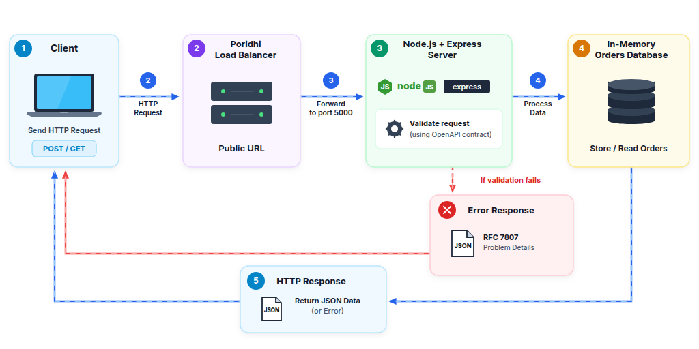

## Scope Note

This lab checks that an `Idempotency-Key` header is present and has UUID format. It does **not** prevent duplicate orders when the same key is reused — real duplicate prevention using Redis is covered in Lab 02.

You will also write `server.js` yourself in this lab; it is a contract-following server skeleton, not code generated automatically by OpenAPI Generator.

## Objectives

By the end of the lab, you should be able to explain what each of these pieces does — not just copy the commands:

- Configure the project workspace with Express and YAML parser dependencies.
- Author an OpenAPI 3.0.3 specification defining `/orders` endpoints, write idempotency headers, query limits, single-order lookups, and RFC 7807 error models.
- Implement an Express server stub that enforces the OpenAPI contract rules and manages in-memory order data.
- Expose the application using the Poridhi Load Balancer on port 5000.
- Verify contract enforcement, boundary restrictions, cursor pagination, and automated unit tests.

## Concepts

**Contract-First Design**
An API architecture approach where the interface specification is defined and reviewed before implementation code is written.

**OpenAPI 3.0.3**
A standardized specification format used to describe endpoints, headers, payload schemas, and response codes.

**Cursor Pagination**
A pagination method that retrieves records sequentially after a unique pointer (`WHERE id > cursor LIMIT limit`), preventing duplicate items during concurrent writes.

**Idempotency Key**
A unique client-provided token supplied via the `Idempotency-Key` HTTP header that identifies a write mutation across retries.

**RFC 7807 Problem Details**
An IETF standard (`application/problem+json`) defining machine-readable HTTP error payloads containing `type`, `title`, `status`, `detail`, and `instance`.

**URI Versioning**
Explicit versioning within the URL path (`/api/v1/...`) that preserves backward compatibility for existing consumers.

## Prerequisites

### Why do you need these tools?

| Tool | Why |
|---|---|
| Node.js | Runs the Express server and the test script. |
| npm | Installs the libraries used by the project. |
| curl | Sends HTTP requests from your terminal. |
| jq | Formats JSON output so it is easier to read. |
| Port 5000 | Where the local API server will listen. |

### Before starting this lab, ensure you have:

- **Node.js**: v20.x or v22.x LTS installed (`node -v`)
- **CLI utilities**: `curl` and `jq` installed (`curl --version`, `jq --version`)
- **Port availability**: host port 5000 must be free — check with `lsof -i :5000` or `netstat -tuln | grep 5000`

## What You Will Build

You will create four files:

- `openapi.yaml` — the written API contract.
- `package.json` — project information, dependencies, and shortcuts for running commands.
- `server.js` — the Express application that handles requests.
- `test.js` — a script that sends requests to your server and checks the results.

```text
lab01-contract-first-api/
├── openapi.yaml   # OpenAPI 3.0.3 contract specification
├── package.json   # Node.js dependencies and script definitions
├── server.js      # Express server enforcing contract rules
└── test.js        # Automated contract validation test suite
```

---

## Step 1: Initialize the Project Workspace

**What you are doing:** creating an empty folder for the lab and telling Node.js which packages the project needs.

**Why it matters:** keeping the files together makes the project easier to run, test, and share.

Start the Poridhi VM and open VS Code. Then create the project directory:

```bash
mkdir -p ~/lab01-contract-first-api
cd ~/lab01-contract-first-api
```

Create a file named `package.json` with the following contents:

```json
{
  "name": "lab01-contract-first-api",
  "version": "1.0.0",
  "description": "Contract-First API with OpenAPI 3",
  "main": "server.js",
  "scripts": {
    "start": "node server.js",
    "test": "node test.js"
  },
  "dependencies": {
    "express": "^4.19.2",
    "yaml": "^2.4.2"
  }
}
```

### Explanation

- **`main`** — points to `server.js` as the entrypoint file of the application.
- **`scripts.start`** — defines the command `node server.js` to run the Express server.
- **`scripts.test`** — defines the command `node test.js` to execute the automated verification test suite.
- **`dependencies.express`** — installs the Express web framework for routing and HTTP handling.
- **`dependencies.yaml`** — installs the YAML parser library to load and inspect `openapi.yaml` at runtime.

Install the project dependencies:

```bash
npm install
```

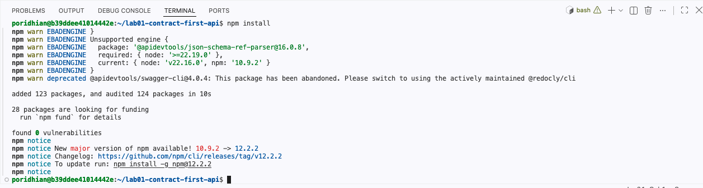

**Expected output:**

```text
added 69 packages in 2s

found 0 vulnerabilities
```

---

## Step 2: Define the OpenAPI 3.0.3 Contract

**What you are doing:** writing the API's agreement in YAML before implementing the routes.

**Why it matters:** the contract gives frontend developers, backend developers, and testers one shared description of the API.

A useful way to read the file:

| Key | Purpose |
|---|---|
| `openapi` | Identifies the OpenAPI specification version. |
| `info` | Describes the API. |
| `servers` | Gives the base URL. |
| `paths` | Lists the endpoints and their methods. |
| `components` | Contains reusable schemas and response definitions. |

Take your time with indentation: YAML uses spaces to show which fields belong inside other fields.

Create a file named `openapi.yaml` with the following contents:

```yaml
openapi: 3.0.3

info:
  title: Orders Service API
  version: 1.0.0
  description: Contract-first API specification supporting cursor
    pagination, idempotency keys, and RFC 7807 error formats.

servers:
  url: http://localhost:5000/api/v1
  description: Local Development Server

paths:
  /orders:
    post:
      summary: Create an order (Idempotent write)
      description: Submits a new order mutation. The client MUST include an
        Idempotency-Key header to prevent duplicate orders upon retries.
      operationId: createOrder
      parameters:
        - name: Idempotency-Key
          in: header
          required: true
          description: Unique client-generated token (UUID v4) guaranteeing
            idempotent execution.
          schema:
            type: string
            format: uuid
          example: "9b1deb4d-3b7d-4bad-9bdd-2b0d7b3dcb6d"
      requestBody:
        required: true
        content:
          application/json:
            schema:
              $ref: '#/components/schemas/CreateOrderRequest'
      responses:
        '201':
          description: Order successfully placed and committed.
          headers:
            Location:
              schema:
                type: string
              example: "/api/v1/orders/101"
          content:
            application/json:
              schema:
                $ref: '#/components/schemas/OrderResponse'
        '400':
          $ref: '#/components/responses/ProblemDetails400'

    get:
      summary: List orders with cursor-based pagination
      description: Retrieves a chronological stream of orders using
        high-performance cursor pagination.
      operationId: listOrders
      parameters:
        - name: cursor
          in: query
          required: false
          description: Opaque cursor identifier representing the last seen order
            ID.
          schema:
            type: integer
          example: 100
        - name: limit
          in: query
          required: false
          description: Number of records to return per page.
          schema:
            type: integer
            minimum: 1
            maximum: 50
            default: 10
          example: 10
      responses:
        '200':
          description: Paginated collection of orders.
          content:
            application/json:
              schema:
                $ref: '#/components/schemas/PaginatedOrdersResponse'
        '400':
          $ref: '#/components/responses/ProblemDetails400'

  /orders/{id}:
    get:
      summary: Retrieve order by ID
      description: Returns the order details matching the provided order ID.
      operationId: getOrderById
      parameters:
        - name: id
          in: path
          required: true
          description: Numeric identifier of the order.
          schema:
            type: integer
          example: 101
      responses:
        '200':
          description: Order found and returned.
          content:
            application/json:
              schema:
                $ref: '#/components/schemas/OrderResponse'
        '404':
          $ref: '#/components/responses/ProblemDetails404'

components:
  schemas:
    CreateOrderRequest:
      type: object
      required:
        - item_id
        - quantity
        - amount
      properties:
        item_id:
          type: integer
          example: 402
        quantity:
          type: integer
          minimum: 1
          example: 2
        amount:
          type: number
          format: float
          minimum: 0.01
          example: 150.50

    OrderResponse:
      type: object
      required:
        - id
        - item_id
        - quantity
        - amount
        - status
        - created_at
      properties:
        id:
          type: integer
          example: 101
        item_id:
          type: integer
          example: 402
        quantity:
          type: integer
          example: 2
        amount:
          type: number
          example: 150.50
        status:
          type: string
          enum: [PENDING, CONFIRMED, COMPLETED]
          example: CONFIRMED
        created_at:
          type: string
          format: date-time
          example: "2026-10-02T10:00:00Z"

    PaginationMetadata:
      type: object
      required:
        - next_cursor
        - has_more
        - count
      properties:
        next_cursor:
          type: integer
          nullable: true
          example: 110
        has_more:
          type: boolean
          example: true
        count:
          type: integer
          example: 10

    PaginatedOrdersResponse:
      type: object
      required:
        - data
        - pagination
      properties:
        data:
          type: array
          items:
            $ref: '#/components/schemas/OrderResponse'
        pagination:
          $ref: '#/components/schemas/PaginationMetadata'

    ProblemDetails:
      type: object
      description: RFC 7807 standard error structure.
      required:
        - type
        - title
        - status
        - detail
      properties:
        type:
          type: string
          format: uri
          example: "https://api.example.com/errors/invalid-parameter"
        title:
          type: string
          example: "Invalid Request Parameter"
        status:
          type: integer
          example: 400
        detail:
          type: string
          example: "The limit parameter exceeds maximum allowed of 50."
        instance:
          type: string
          example: "/api/v1/orders"

  responses:
    ProblemDetails400:
      description: Bad Request (RFC 7807 Problem Details).
      content:
        application/problem+json:
          schema:
            $ref: '#/components/schemas/ProblemDetails'

    ProblemDetails404:
      description: Not Found (RFC 7807 Problem Details).
      content:
        application/problem+json:
          schema:
            $ref: '#/components/schemas/ProblemDetails'
```

### Explanation

- **`servers.url`** — specifies `http://localhost:5000/api/v1` as the base URI path to enforce explicit API versioning.
- **`paths./orders.post.parameters`** — declares the `Idempotency-Key` header with `required: true` and UUID formatting.
- **`paths./orders.get.parameters`** — defines `cursor` and `limit` query parameters with explicit validation boundaries (`minimum: 1`, `maximum: 50`, `default: 10`).
- **`paths./orders/{id}.get`** — specifies the resource retrieval endpoint matching the `Location` header emitted on successful creation.
- **`components.schemas.CreateOrderRequest`** — enforces mandatory fields (`item_id`, `quantity`, `amount`) and minimum values (`quantity >= 1`, `amount >= 0.01`).
- **`components.schemas.ProblemDetails`** — declares the RFC 7807 error format with `type`, `title`, `status`, `detail`, and `instance` properties.
- **`components.responses.ProblemDetails400` / `ProblemDetails404`** — map standard HTTP client errors to `application/problem+json`.

---

## Step 3: Implement the Contract-Compliant Server Stub

**What you are doing:** creating the Express application that receives HTTP requests and applies the important rules described in the contract.

**Why it matters:** an OpenAPI document describes the API, but it does not by itself run a server. Express provides the running application.

Before reading the code, know these basics:

| Concept | Meaning |
|---|---|
| Route | Connects an HTTP method and URL to a function. |
| `req` | Contains information sent by the client. |
| `res` | Used to send the response. |
| `req.body` | Contains JSON sent in the request body. |
| `req.query` | Contains query parameters such as `limit` and `cursor`. |
| `req.params` | Contains values from a path such as `:id`. |

The server code below is intentionally small and uses an in-memory array so you can focus on the API contract.

Create a file named `server.js` with the following contents:

```javascript
const express = require('express');
const fs = require('fs');
const path = require('path');
const yaml = require('yaml');

const app = express();
const PORT = process.env.PORT || 5000;

app.use(express.json());

// Load OpenAPI 3 contract (Single Source of Truth)
const openapiPath = path.join(__dirname, 'openapi.yaml');
const openapiSpec = yaml.parse(fs.readFileSync(openapiPath, 'utf8'));

// Helper: RFC 7807 Problem Details Formatter
function sendProblem(res, status, title, detail, instance, type = 'about:blank') {
  res.setHeader('Content-Type', 'application/problem+json');
  return res.status(status).json({
    type,
    title,
    status,
    detail,
    instance
  });
}

// In-Memory Orders Database (Seeded with 25 records for pagination testing)
let ordersDb = [];
let nextOrderId = 101;

for (let i = 1; i <= 25; i++) {
  ordersDb.push({
    id: nextOrderId++,
    item_id: 400 + (i % 5),
    quantity: (i % 3) + 1,
    amount: parseFloat((25.5 * i).toFixed(2)),
    status: 'CONFIRMED',
    created_at: new Date(Date.now() - (25 - i) * 60000).toISOString()
  });
}

// Route: Expose raw OpenAPI Spec
app.get('/openapi.yaml', (req, res) => {
  res.setHeader('Content-Type', 'text/yaml');
  res.sendFile(openapiPath);
});

// UUID v4 validation regex per OpenAPI format specification
const UUID_V4_REGEX = /^[0-9a-f]{8}-[0-9a-f]{4}-4[0-9a-f]{3}-[89ab][0-9a-f]{3}-[0-9a-f]{12}$/i;

// Route: POST /api/v1/orders (Contract-Driven Mutation Endpoint)
app.post('/api/v1/orders', (req, res) => {
  const idempotencyKey = req.header('Idempotency-Key');

  // Contract Check 1: Header presence
  if (!idempotencyKey) {
    return sendProblem(
      res,
      400,
      'Missing Required Header',
      'The Idempotency-Key header is required for this write operation.',
      '/api/v1/orders',
      'https://api.example.com/errors/missing-header'
    );
  }

  // Contract Check 2: Header UUID format compliance
  if (!UUID_V4_REGEX.test(idempotencyKey)) {
    return sendProblem(
      res,
      400,
      'Invalid Header Format',
      'The Idempotency-Key header must be a valid UUID string.',
      '/api/v1/orders',
      'https://api.example.com/errors/invalid-header'
    );
  }

  // Contract Check 3: Request Body fields & types
  const { item_id, quantity, amount } = req.body || {};

  if (typeof item_id !== 'number' || typeof quantity !== 'number' || typeof amount !== 'number') {
    return sendProblem(
      res,
      400,
      'Invalid Request Body',
      'item_id, quantity, and amount must all be numbers.',
      '/api/v1/orders',
      'https://api.example.com/errors/invalid-body'
    );
  }

  if (quantity < 1 || amount <= 0) {
    return sendProblem(
      res,
      400,
      'Value Out of Bounds',
      'quantity must be >= 1 and amount must be > 0.',
      '/api/v1/orders',
      'https://api.example.com/errors/out-of-bounds'
    );
  }

  // Create Order Entity
  const newOrder = {
    id: nextOrderId++,
    item_id,
    quantity,
    amount: parseFloat(amount.toFixed(2)),
    status: 'CONFIRMED',
    created_at: new Date().toISOString()
  };

  ordersDb.push(newOrder);

  // Return RFC 9110 compliant Location header pointing to resource URL
  res.setHeader('Location', `/api/v1/orders/${newOrder.id}`);

  return res.status(201).json(newOrder);
});

// Route: GET /api/v1/orders/:id (Retrieve Single Order by ID)
app.get('/api/v1/orders/:id', (req, res) => {
  const orderId = parseInt(req.params.id, 10);

  if (isNaN(orderId)) {
    return sendProblem(
      res,
      400,
      'Invalid Parameter',
      'Order ID path parameter must be an integer.',
      req.originalUrl,
      'https://api.example.com/errors/invalid-parameter'
    );
  }

  const order = ordersDb.find((o) => o.id === orderId);

  if (!order) {
    return sendProblem(
      res,
      404,
      'Order Not Found',
      `No order found with ID ${orderId}.`,
      req.originalUrl,
      'https://api.example.com/errors/not-found'
    );
  }

  return res.status(200).json(order);
});

// Route: GET /api/v1/orders (Cursor-Based Pagination Endpoint)
app.get('/api/v1/orders', (req, res) => {
  let limit = parseInt(req.query.limit, 10);

  if (isNaN(limit)) {
    limit = 10; // Default per OpenAPI contract
  }

  // Contract Check: Limit bounds 1..50
  if (limit < 1 || limit > 50) {
    return sendProblem(
      res,
      400,
      'Invalid Query Parameter',
      `The limit parameter must be between 1 and 50. Received: ${req.query.limit}`,
      '/api/v1/orders',
      'https://api.example.com/errors/invalid-parameter'
    );
  }

  const cursor = req.query.cursor ? parseInt(req.query.cursor, 10) : 0;

  // Filter records chronologically after cursor ID
  const filtered = ordersDb.filter((o) => o.id > cursor);

  const pageItems = filtered.slice(0, limit);
  const nextCursor = pageItems.length > 0 ? pageItems[pageItems.length - 1].id : null;
  const hasMore = filtered.length > limit;

  return res.status(200).json({
    data: pageItems,
    pagination: {
      next_cursor: hasMore ? nextCursor : null,
      has_more: hasMore,
      count: pageItems.length
    }
  });
});

if (require.main === module) {
  app.listen(PORT, () => {
    console.log(`[Contract-First Server] Running on port ${PORT}`);
    console.log(`OpenAPI Spec accessible at http://localhost:${PORT}/openapi.yaml`);
  });
}

module.exports = app;
```

### Explanation

- **`yaml.parse(fs.readFileSync(...))`** — reads and parses `openapi.yaml` into memory upon server startup.
- **`sendProblem()`** — helper function setting `Content-Type: application/problem+json` and returning RFC 7807-compliant error payloads.
- **`ordersDb`** — in-memory array pre-seeded with 25 records to enable immediate cursor pagination verification.
- **`UUID_V4_REGEX`** — validates the `Idempotency-Key` header against the UUID v4 format specified in `openapi.yaml`.
- **`res.setHeader('Location', ...)`** — returns the resource URI for newly created orders alongside HTTP 201 Created.
- **`app.get('/api/v1/orders/:id')`** — provides the endpoint backing the `Location` header so consumers can immediately resolve created resources.
- **`ordersDb.filter((o) => o.id > cursor)`** — executes cursor-based pagination by selecting items strictly greater than the cursor ID and slicing up to the validated limit.

---

## Step 4: Expose the Server via Poridhi Load Balancer

**What you are doing:** starting your local API and making it reachable through the Poridhi Load Balancer.

**Why it matters:** your server listens inside the lab environment. The load balancer provides a public URL that can forward requests to that server.

Open a terminal and start the server process in the background on port 5000:

```bash
node server.js &
```

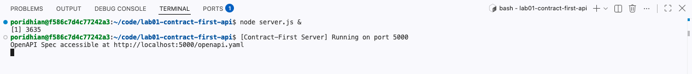

Retrieve the private IP address of your virtual machine:

```bash
hostname -I | awk '{print $1}'
```

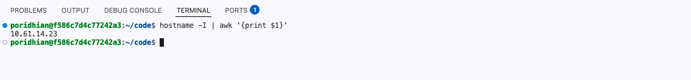

Configure the Poridhi Load Balancer:

1. Open the **Load Balancer** modal in the Poridhi interface.
2. Enter the IP address obtained from `hostname -I`.
3. Set the target port to **5000**.
4. Click **Expose** to generate an active public URL.

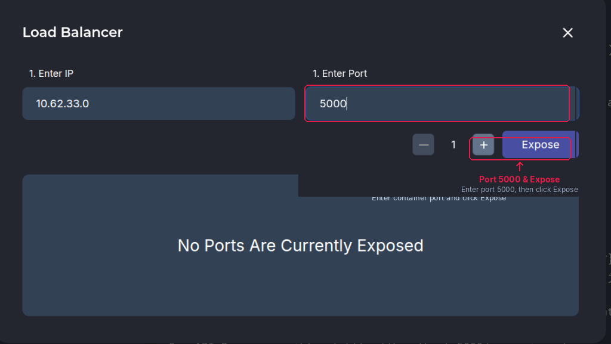
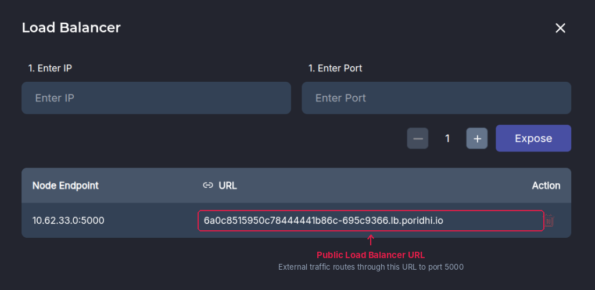

Open the generated Load Balancer URL in your web browser to confirm connectivity:

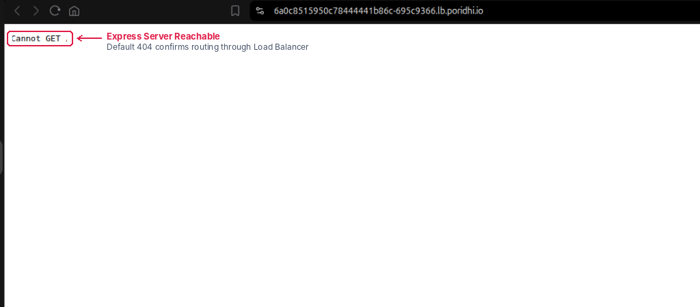

---

## Verification

Now that the server is running, you will send requests to check whether it follows the expected API behavior.

### How to read each test

1. Run the command.
2. Look at the HTTP status code.
3. Look at the response headers and JSON body.
4. Compare the actual result with the expected output.
5. Read the "What to Observe" note to understand what the test proves.

You will verify contract validation, mutation handling, query parameter limits, single-item retrieval, and cursor pagination using `curl` and the automated test runner.

### Scenario 1: Missing Idempotency-Key Header (Expected 400 Bad Request)

**What are we testing?** The contract says every order-creation request must include an `Idempotency-Key` header. This request intentionally leaves it out, so the server should reject it.

Execute a POST request without the `Idempotency-Key` header:

```bash
curl -i -X POST http://localhost:5000/api/v1/orders \
  -H "Content-Type: application/json" \
  -d '{"item_id": 402, "quantity": 1, "amount": 99.50}'
```

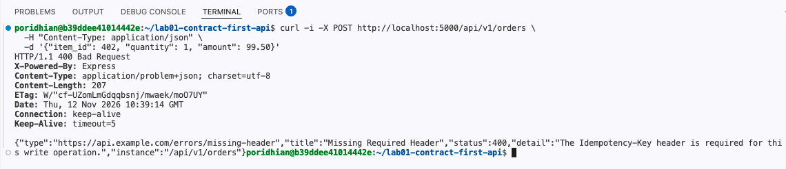

**Expected output:**

```text
HTTP/1.1 400 Bad Request
Content-Type: application/problem+json; charset=utf-8

{
  "type": "https://api.example.com/errors/missing-header",
  "title": "Missing Required Header",
  "status": 400,
  "detail": "The Idempotency-Key header is required for this write operation.",
  "instance": "/api/v1/orders"
}
```

**What to Observe:** The server returns standard RFC 7807 `application/problem+json` specifying `status: 400` and `title: Missing Required Header`.

### Scenario 2: Valid Order Placement & Resource Lookup (Expected 201 Created & 200 OK)

**What are we testing?** First, send a valid order. Then use the URL returned in the `Location` response header to retrieve that same order.

- **201 Created** means a new resource was created.
- **Location** tells the client where the new resource can be retrieved.
- **200 OK** means the follow-up retrieval succeeded.

Execute a POST request supplying a valid `Idempotency-Key` UUID header:

```bash
curl -i -X POST http://localhost:5000/api/v1/orders \
  -H "Content-Type: application/json" \
  -H "Idempotency-Key: 9b1deb4d-3b7d-4bad-9bdd-2b0d7b3dcb6d" \
  -d '{"item_id": 402, "quantity": 2, "amount": 199.00}'
```

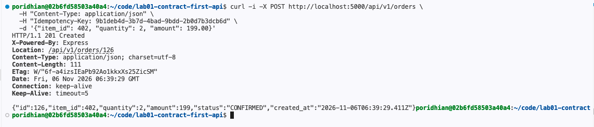

**Expected output:**

```text
HTTP/1.1 201 Created
Location: /api/v1/orders/126
Content-Type: application/json; charset=utf-8

{
  "id": 126,
  "item_id": 402,
  "quantity": 2,
  "amount": 199,
  "status": "CONFIRMED",
  "created_at": "2026-10-02T02:00:00.000Z"
}
```

Now retrieve the created resource using the URI returned in the `Location` header:

```bash
curl -i http://localhost:5000/api/v1/orders/126
```

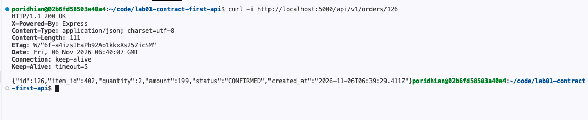

**Expected output:**

```text
HTTP/1.1 200 OK
Content-Type: application/json; charset=utf-8

{
  "id": 126,
  "item_id": 402,
  "quantity": 2,
  "amount": 199,
  "status": "CONFIRMED",
  "created_at": "2026-10-02T02:00:00.000Z"
}
```

**What to Observe:** The `Location: /api/v1/orders/126` header points to a resolvable resource that returns 200 OK with the exact committed state.

### Scenario 3: Query Parameter Limit Out of Bounds (Expected 400 Bad Request)

**What are we testing?** The contract allows a page size from 1 to 50. We deliberately ask for 100, so the server should return a clear 400 Bad Request error instead of accepting the invalid value.

Query `/api/v1/orders` with `limit=100`, exceeding the contract maximum of 50:

```bash
curl -i "http://localhost:5000/api/v1/orders?limit=100"
```

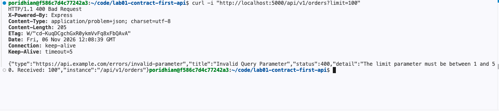

**Expected output:**

```text
HTTP/1.1 400 Bad Request
Content-Type: application/problem+json; charset=utf-8

{
  "type": "https://api.example.com/errors/invalid-parameter",
  "title": "Invalid Query Parameter",
  "status": 400,
  "detail": "The limit parameter must be between 1 and 50. Received: 100",
  "instance": "/api/v1/orders"
}
```

**What to Observe:** The contract boundary of `maximum: 50` is enforced, rejecting out-of-range `limit` queries before database retrieval.

### Scenario 4: Cursor-Based Pagination

**What are we testing?** We ask for the first three orders, read the `next_cursor` value, and use it to request the next page.

For example, if page one ends with order ID 103, page two uses `cursor=103`. The server filters for IDs greater than 103, so the next page starts at 104 in this sample.

Retrieve the first page with `limit=3`:

```bash
curl -s "http://localhost:5000/api/v1/orders?limit=3" | jq .
```

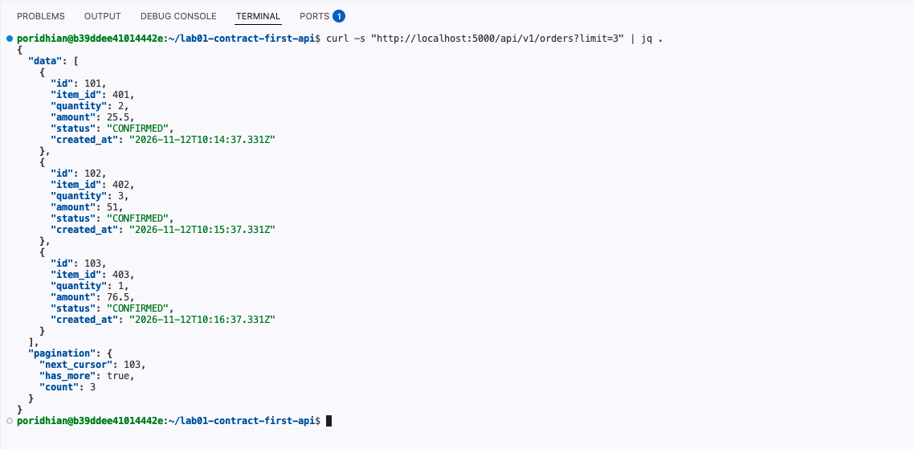

**Expected output:**

```json
{
  "data": [
    { "id": 101, "item_id": 401, "quantity": 2, "amount": 25.5, "status": "CONFIRMED" },
    { "id": 102, "item_id": 402, "quantity": 3, "amount": 51, "status": "CONFIRMED" },
    { "id": 103, "item_id": 403, "quantity": 1, "amount": 76.5, "status": "CONFIRMED" }
  ],
  "pagination": {
    "next_cursor": 103,
    "has_more": true,
    "count": 3
  }
}
```

Retrieve the second page using `cursor=103`:

```bash
curl -s "http://localhost:5000/api/v1/orders?limit=3&cursor=103" | jq .
```

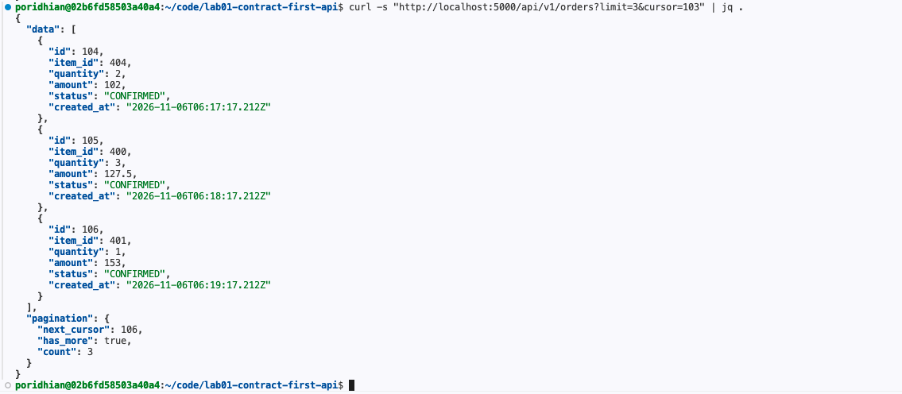

**Expected output:**

```json
{
  "data": [
    { "id": 104, "item_id": 404, "quantity": 2, "amount": 102, "status": "CONFIRMED" },
    { "id": 105, "item_id": 400, "quantity": 3, "amount": 127.5, "status": "CONFIRMED" },
    { "id": 106, "item_id": 401, "quantity": 1, "amount": 153, "status": "CONFIRMED" }
  ],
  "pagination": {
    "next_cursor": 106,
    "has_more": true,
    "count": 3
  }
}
```

**What to Observe:** The second page starts strictly at ID 104 (`WHERE id > 103`), with zero item overlap between page requests.

### Scenario 5: Automated Contract Validation Test Suite

**What are we testing?** Instead of manually running each request, `test.js` sends several requests automatically and checks their status codes and response data.

The script starts the Express app on a temporary port, runs the checks, and closes the test server when finished.

Create a file named `test.js` with the following contents:

```javascript
const http = require('http');
const app = require('./server');

const server = app.listen(0, async () => {
  const port = server.address().port;
  const baseUrl = `http://localhost:${port}`;

  console.log(`[TEST RUNNER] Running contract verification against port ${port}...\n`);

  function request(method, path, headers = {}, body = null) {
    return new Promise((resolve, reject) => {
      const url = new URL(path, baseUrl);
      const req = http.request(
        url,
        {
          method,
          headers: { 'Content-Type': 'application/json', ...headers }
        },
        (res) => {
          let data = '';
          res.on('data', (chunk) => (data += chunk));
          res.on('end', () => {
            let parsed = null;
            try {
              parsed = JSON.parse(data);
            } catch (e) {
              parsed = data;
            }
            resolve({ status: res.statusCode, headers: res.headers, body: parsed });
          });
        }
      );

      req.on('error', reject);
      if (body) req.write(JSON.stringify(body));
      req.end();
    });
  }

  try {
    // Test 1: Missing Idempotency-Key on POST -> Expect 400 Problem Details
    console.log('Test 1: Asserting 400 Bad Request when Idempotency-Key header is omitted...');
    const res1 = await request('POST', '/api/v1/orders', {}, { item_id: 1, quantity: 2, amount: 50.0 });

    if (res1.status === 400 && res1.body.title === 'Missing Required Header') {
      console.log('  PASS: 400 RFC 7807 returned properly for missing header.\n');
    } else {
      throw new Error(`Test 1 Failed: Received status ${res1.status}`);
    }

    // Test 2: Valid Order Creation with Idempotency-Key -> Expect 201 Created
    console.log('Test 2: Creating an order with valid schema and Idempotency-Key...');
    const res2 = await request(
      'POST',
      '/api/v1/orders',
      { 'Idempotency-Key': '9b1deb4d-3b7d-4bad-9bdd-2b0d7b3dcb6d' },
      { item_id: 402, quantity: 3, amount: 199.99 }
    );

    if (res2.status === 201 && res2.body.id && res2.headers.location) {
      console.log(`  PASS: 201 Created returned. Order ID: ${res2.body.id}, Location: ${res2.headers.location}\n`);
    } else {
      throw new Error(`Test 2 Failed: Received status ${res2.status}`);
    }

    // Test 3: Pagination Limit Out of Bounds (limit > 50) -> Expect 400 Problem Details
    console.log('Test 3: Requesting pagination limit=100 (exceeding max 50 contract rule)...');
    const res3 = await request('GET', '/api/v1/orders?limit=100');

    if (res3.status === 400 && res3.body.title === 'Invalid Query Parameter') {
      console.log('  PASS: 400 RFC 7807 returned for limit out of bounds.\n');
    } else {
      throw new Error(`Test 3 Failed: Received status ${res3.status}`);
    }

    // Test 4: Cursor-based Pagination Retrieval -> Expect 200 OK with next_cursor
    console.log('Test 4: Querying first page of orders (limit=5)...');
    const res4 = await request('GET', '/api/v1/orders?limit=5');

    if (res4.status === 200 && res4.body.data.length === 5 && res4.body.pagination.next_cursor) {
      const nextCursor = res4.body.pagination.next_cursor;
      console.log(`  PASS: Page 1 returned 5 items. Next cursor token: ${nextCursor}`);
      console.log(`  Querying Page 2 using cursor=${nextCursor}...`);

      const res5 = await request('GET', `/api/v1/orders?limit=5&cursor=${nextCursor}`);

      if (res5.status === 200 && res5.body.data.length === 5 && res5.body.data[0].id > nextCursor) {
        console.log(`  PASS: Page 2 returned next 5 items without overlap. First item ID: ${res5.body.data[0].id}\n`);
      } else {
        throw new Error('Test 4 Page 2 Failed');
      }
    } else {
      throw new Error(`Test 4 Failed: Received status ${res4.status}`);
    }

    console.log('  ALL 4 CONTRACT-FIRST API TESTS PASSED SUCCESSFULLY!');
  } catch (err) {
    console.error('Test suite failed:', err);
    process.exitCode = 1;
  } finally {
    server.close();
  }
});
```

### Explanation

- **`app.listen(0)`** — spawns the Express server on an ephemeral random port to isolate automated tests from active server instances.
- **`request()`** — wraps Node.js `http.request` into a promise-based client to test status codes, headers, and parsed JSON responses.
- **Test 1** — asserts that omitting `Idempotency-Key` triggers an HTTP 400 status with RFC 7807 payload title `Missing Required Header`.
- **Test 2** — asserts that supplying a valid body and key produces HTTP 201 Created with a populated `Location` header.
- **Test 3** — asserts that requesting `limit=100` triggers HTTP 400 Bad Request with `Invalid Query Parameter`.
- **Test 4** — asserts that sequential queries across pages yield distinct records without ID overlap using `next_cursor`.

Execute `npm test` to run the test suite:

```bash
npm test
```

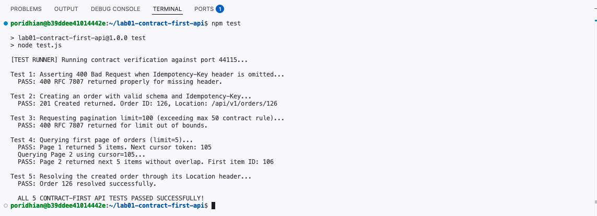

**Expected output:**

```text
> lab01-contract-first-api@1.0.0 test
> node test.js

[TEST RUNNER] Running contract verification against port 39707...

Test 1: Asserting 400 Bad Request when Idempotency-Key header is omitted...
  PASS: 400 RFC 7807 returned properly for missing header.

Test 2: Creating an order with valid schema and Idempotency-Key...
  PASS: 201 Created returned. Order ID: 126, Location: /api/v1/orders/126

Test 3: Requesting pagination limit=100 (exceeding max 50 contract rule)...
  PASS: 400 RFC 7807 returned for limit out of bounds.

Test 4: Querying first page of orders (limit=5)...
  PASS: Page 1 returned 5 items. Next cursor token: 105
  Querying Page 2 using cursor=105...
  PASS: Page 2 returned next 5 items without overlap. First item ID: 106

  ALL 4 CONTRACT-FIRST API TESTS PASSED SUCCESSFULLY!
```

---

## Troubleshooting

If a command fails, do not immediately change the code. First check the error message and confirm that you completed the previous step.

| Issue | Cause | Solution |
|---|---|---|
| `Error: listen EADDRINUSE :::5000` | Another process is already running on port 5000 (e.g. from an earlier run or Lab 02). | Run `lsof -i :5000` to find the process ID, then `kill -9 <PID>`, or run `pkill -f "node server.js"`. |
| `curl: (7) Failed to connect to localhost port 5000` | The Express server process is not active or crashed on boot. | Start the server with `node server.js` in a dedicated terminal and inspect console error outputs. |
| `jq: command not found` | The `jq` JSON parsing utility is not installed on the system. | Install it using `sudo apt-get update && sudo apt-get install -y jq`. |

---

## Teardown & Cleanup

When you have finished testing this lab, stop the background Node.js server before starting Lab 02:

```bash
pkill -f "node server.js" || true
```

Confirm port 5000 is released:

```bash
lsof -i :5000
```
