# Lab 02 — Idempotent Write Endpoint with Node.js and Redis

> **Module 06 — API Design & Networking Essentials** · Lab 2
> **Difficulty:** Intermediate · **Estimated Time:** 30–35 minutes

You will build a write endpoint that is safe under client retries. The service intercepts every mutation on `POST /api/v1/orders`, acquires an atomic mutual exclusion lock in Redis using `SET key value EX 60 NX`, caches successful responses (2xx only) with a 24-hour TTL, releases the lock on validation failure so a bad request never poisons the key, and fails closed with 503 Service Unavailable when Redis is unreachable.

The deliverable is an automated test that proves the central claim: **two identical requests with the same `Idempotency-Key` produce exactly one order.**

The stack is Node.js, Express, Redis 7, and Docker Compose.

<p align="center">
  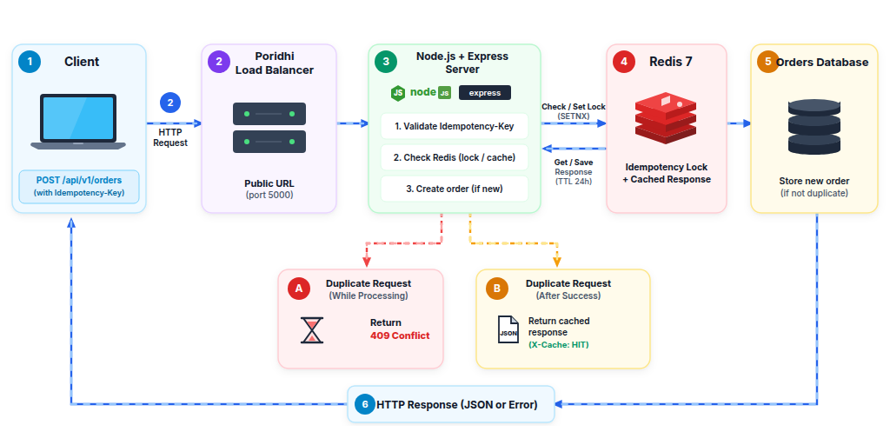
</p>

## Why these tools?

Node.js runs the API, Docker Compose starts Redis, and `curl`/`jq` help you test and inspect the API. Port 5000 is used by the application and port 6379 by Redis. Redis is not optional decoration here: an in-process `Map` cannot give you mutual exclusion across processes or across machines, and it cannot survive a restart. A shared key store can.

| Tool | Role in this lab | Beginner explanation |
| :--- | :--- | :--- |
| Node.js | Runs the server | Executes JavaScript outside the browser |
| Express | Handles HTTP requests | Helps define API routes and send responses |
| Redis | Stores locks and cached responses | A fast key-value store |
| Docker Compose | Starts Redis | Runs the Redis container using a configuration file |
| `curl` | Sends API requests | Lets you test an endpoint from the terminal |
| `jq` | Formats JSON | Makes JSON output easier to read |

---

## Prerequisites

Before starting this lab, ensure you have:

- **Node.js:** v20.x or v22.x LTS installed (`node -v`)
- **Docker & Docker Compose:** Docker Engine v24+ and Docker Compose v2+ installed (`docker --version`, `docker compose version`)
- **CLI Utilities:** `curl` and `jq` installed (`curl --version`, `jq --version`)
- **Port Availability:** Host ports 5000 (application) and 6379 (Redis) must be free


---

## Concepts

| Term | Definition |
| :--- | :--- |
| **Idempotency** | A property of an API operation where making the same request multiple times produces the identical side effect as making it once (f(f(x)) = f(x)). |
| **Atomic Lock (SETNX)** | A Redis primitive (`SET key value EX ttl NX`) that sets a key only if it does not already exist, guaranteeing atomic mutual exclusion across distributed workers. |
| **IN_PROGRESS State** | A transient lock status indicating that a mutation is actively processing, allowing the server to reject concurrent duplicates with 409 Conflict. |
| **Selective 2xx Response Caching** | Storing only successful (2xx) mutation results in Redis. On client (4xx) or server (5xx) errors, the key lock is deleted (`DEL`) so client retries are not poisoned. |
| **TTL Expiration (EX 86400)** | An automated expiration timer that clears idempotency records after 24 hours to prevent memory exhaustion while covering client retry windows. |
| **Fail-Closed Safety** | Rejecting write mutations with 503 Service Unavailable if Redis is unreachable, preventing dangerous duplicate writes and silent financial anomalies. |
| **Idempotency Replay** | Returning the previously stored status code, `Location` header, and response body instead of re-executing the mutation. |

When a write request arrives, the idempotency middleware extracts the client-supplied `Idempotency-Key` header and checks Redis for an existing record. If the key does not exist, the middleware atomically acquires a lock by executing `SET idemp:<key> "IN_PROGRESS" EX 60 NX`. The application executes the business logic, commits the mutation to the database, and caches the serialized HTTP status code, `Location` header, and response body in Redis. If a duplicate request arrives while the operation is in flight, the server returns 409 Conflict. If a duplicate request arrives after completion, the server immediately replays the cached response with `X-Cache: HIT` and `Idempotency-Replay: true`, bypassing the database entirely.

---

## Objectives

By the end of this lab, you will be able to:

- Deploy a Redis 7 key store with automated health checks using Docker Compose.
- Implement an Express idempotency middleware handling key validation, atomic locking, 2xx-only caching, and fail-closed safety.
- Include and preserve `Location` headers across initial mutations and cache replays per RFC 9110.
- Guard administrative reset routes against unauthenticated production invocations.
- Expose the application via the Poridhi Load Balancer on port 5000.
- Prove with an automated test that duplicate requests produce exactly one order, and that concurrent requests produce exactly one order and one 409.

---

## What You Will Build

```text
lab02-idempotent-write-endpoint/
├── docker-compose.yml      # Redis 7 service definition with healthcheck
├── package.json            # Node.js dependencies and script definitions
├── server.js               # Express server with Redis Idempotency Middleware
└── test-idempotency.js     # Automated retry and concurrency race condition test
```

The files have three jobs: Docker Compose starts Redis, `server.js` implements the API and middleware, and `test-idempotency.js` checks retries and simultaneous requests.

---

## Step 1: Initialize the Project Workspace

**What you are doing:** creating an empty folder for the lab and declaring which packages the project needs.

**Why it matters:** keeping the files together makes the project easier to run, test, and share.

Start the Poridhi VM and open VS Code, then create the project directory:

```bash
mkdir -p ~/lab02-idempotent-write-endpoint
cd ~/lab02-idempotent-write-endpoint
```

Create a file named `package.json` with the following contents:

```json
{
  "name": "lab02-idempotent-write-endpoint",
  "version": "1.0.0",
  "description": "Idempotent Write Endpoint with Node.js and Redis",
  "main": "server.js",
  "scripts": {
    "start": "node server.js",
    "test": "node test-idempotency.js"
  },
  "dependencies": {
    "express": "^4.19.2",
    "ioredis": "^5.4.1"
  }
}
```

**Explanation:**

- `main` — designates `server.js` as the application entrypoint.
- `scripts.start` — defines the start command to launch the Express server.
- `scripts.test` — defines the automated test command executing `test-idempotency.js`.
- `dependencies.express` — installs Express to handle HTTP routing and middleware chaining.
- `dependencies.ioredis` — installs the Redis client supporting promises and atomic operations.

Install the project dependencies:

```bash
npm install
```

<p align="center">
  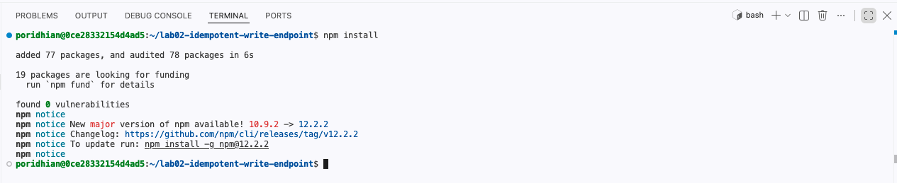
</p>

**Expected output:**

```text
added 77 packages, and audited 78 packages in 6s

19 packages are looking for funding
  run `npm fund` for details

found 0 vulnerabilities
```

---

## Step 2: Start the Redis Key Store with Docker Compose

**What you are doing:** starting Redis in a container so the idempotency middleware has somewhere to store locks and cached responses.

**Why it matters:** Redis is what makes the lock atomic. Two requests arriving at the same moment must not both believe they own the key, and only a single shared store can decide that reliably.

Create a file named `docker-compose.yml` with the following contents:

```yaml
services:
  redis:
    image: redis:7-alpine
    container_name: lab02-redis
    ports:
      - "6379:6379"
    restart: unless-stopped
    command: redis-server --appendonly yes
    healthcheck:
      test: ["CMD", "redis-cli", "ping"]
      interval: 5s
      timeout: 3s
      retries: 5
```

**Explanation:**

- `image: redis:7-alpine` — uses the official lightweight Alpine Linux Redis 7 image.
- `container_name: lab02-redis` — assigns a fixed container identifier.
- `ports: "6379:6379"` — maps host port 6379 to the Redis container port.
- `command: redis-server --appendonly yes` — enables AOF (Append Only File) persistence to record mutation operations to disk.
- `healthcheck` — regularly probes the container with `redis-cli ping` so dependencies can verify readiness.

Launch the Redis container in the background:

```bash
docker compose up -d redis
```

<p align="center">
  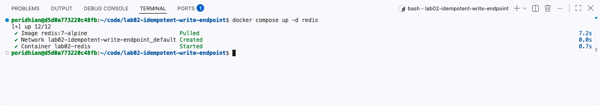
</p>

**Expected output:**

```text
[+] Running 2/2
 ✔ Network lab02-idempotent-write-endpoint_default  Created
 ✔ Container lab02-redis  Started
```

Verify Redis connectivity:

```bash
docker compose exec redis redis-cli ping
```

<p align="center">
  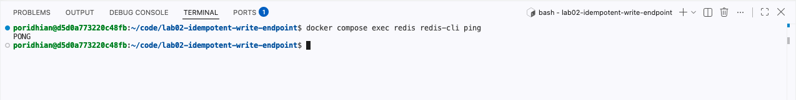
</p>

**Expected output:**

```text
PONG
```

`PONG` means Redis is alive and accepting commands. If you see `Connection refused` instead, the container has not finished starting — wait a few seconds and run the command again.

---

## Step 3: Implement the Idempotency Middleware and Server Stub

**What you are doing:** creating the Express application that intercepts writes, coordinates them through Redis, and stores the result so a retry can be replayed instead of repeated.

**Why it matters:** an OpenAPI document or a route handler alone cannot make a write safe under retries. Safety comes from the middleware sequence below, and every line of it exists for a reason.

Before reading the code, remember this sequence:

1. Read the `Idempotency-Key` header.
2. Check Redis for an existing state or saved response.
3. If the key is new, try to create an `IN_PROGRESS` lock using `SET ... NX`.
4. If the lock is acquired, continue to the order route.
5. Validate the input and create the order.
6. Save the successful response in Redis so a retry can replay it.

You do not need to memorize every line at once. First understand this flow, then connect each code block to its purpose.

Here is how a request travels through the middleware:

```text
Client
  |
  | POST /api/v1/orders + Idempotency-Key
  v
Express API
  |
  v
Idempotency middleware
  |
  +--> Check Redis
  |      |
  |      +--> Saved response found --> Replay saved response
  |      |
  |      +--> IN_PROGRESS found ----> Return 409 Conflict
  |      |
  |      +--> Key not found --------> Acquire lock
  |
  v
Create the order
  |
  v
Save successful response in Redis
```

> **Remember:** use the same key when retrying the same operation. Use a new key for a genuinely new order.

Create a file named `server.js` with the following contents:

```javascript
const express = require('express');
const Redis = require('ioredis');

const app = express();

const PORT = process.env.PORT || 5000;
const REDIS_URL = process.env.REDIS_URL || 'redis://127.0.0.1:6379';

app.use(express.json());

// ==========================================
// Redis Client Configuration
// ==========================================

const redis = new Redis(REDIS_URL, {
  maxRetriesPerRequest: 3,
  enableOfflineQueue: false,

  retryStrategy(times) {
    if (times > 3) return null;
    return Math.min(times * 100, 2000);
  }
});

redis.on('connect', () => {
  console.log('[REDIS] Connecting...');
});

redis.on('ready', () => {
  console.log('[REDIS] Connection ready');
});

redis.on('error', (err) => {
  console.error('[REDIS ERROR]', err.message);
});

redis.on('close', () => {
  console.log('[REDIS] Connection closed');
});

// Explicit Redis readiness check
async function waitForRedis() {
  if (redis.status !== 'ready') {
    await new Promise((resolve, reject) => {
      const onReady = () => {
        cleanup();
        resolve();
      };

      const onError = (err) => {
        cleanup();
        reject(err);
      };

      const cleanup = () => {
        redis.removeListener('ready', onReady);
        redis.removeListener('error', onError);
      };

      redis.once('ready', onReady);
      redis.once('error', onError);
    });
  }

  await redis.ping();
}

// ==========================================
// In-Memory Database
// ==========================================

let orders = [];
let nextId = 1;

// ==========================================
// Idempotency Middleware Factory
// ==========================================

function idempotencyMiddleware(ttlSeconds = 86400) {
  return async (req, res, next) => {
    const key = req.header('Idempotency-Key');

    // Apply only to write mutations
    if (!['POST', 'PUT', 'PATCH'].includes(req.method)) {
      return next();
    }

    if (!key) {
      return res.status(400).json({
        type: 'https://api.example.com/errors/missing-idempotency-key',
        title: 'Missing Idempotency-Key Header',
        status: 400,
        detail: 'An Idempotency-Key header is required for this operation.'
      });
    }

    const redisKey = `idemp:${key}`;

    try {
      // 1. Check existing state
      const cached = await redis.get(redisKey);

      if (cached) {
        if (cached === 'IN_PROGRESS') {
          return res.status(409).json({
            type: 'https://api.example.com/errors/concurrent-mutation',
            title: 'Conflict: Mutation In Progress',
            status: 409,
            detail:
              'A request with this Idempotency-Key is currently being processed. Please retry shortly.'
          });
        }

        // Replay cached response
        const record = JSON.parse(cached);

        res.setHeader('X-Cache', 'HIT');
        res.setHeader('Idempotency-Replay', 'true');

        if (record.headers?.location) {
          res.setHeader('Location', record.headers.location);
        }

        return res.status(record.status).json(record.body);
      }

      // 2. Acquire atomic lock
      const acquired = await redis.set(redisKey, 'IN_PROGRESS', 'EX', 60, 'NX');

      if (!acquired) {
        return res.status(409).json({
          type: 'https://api.example.com/errors/concurrent-mutation',
          title: 'Conflict: Concurrent Request',
          status: 409,
          detail: 'Another client is currently executing with this Idempotency-Key.'
        });
      }

      // 3. Cache miss
      res.setHeader('X-Cache', 'MISS');

      const originalJson = res.json.bind(res);

      let responseHandled = false;

      res.json = (body) => {
        if (responseHandled) {
          return originalJson(body);
        }

        responseHandled = true;

        if (res.statusCode >= 200 && res.statusCode < 300) {
          const payloadToCache = {
            status: res.statusCode,
            headers: {
              location: res.getHeader('Location') || null
            },
            body
          };

          redis
            .set(redisKey, JSON.stringify(payloadToCache), 'EX', ttlSeconds)
            .catch((err) => {
              console.error('[IDEMPOTENCY] Failed to save result:', err.message);
            });
        } else {
          redis.del(redisKey).catch((err) => {
            console.error('[IDEMPOTENCY] Failed to release lock:', err.message);
          });
        }

        return originalJson(body);
      };

      // Release lock if connection closes before response
      res.on('close', () => {
        if (!res.writableEnded) {
          redis.del(redisKey).catch((err) => {
            console.error('[IDEMPOTENCY] Failed to release abandoned lock:', err.message);
          });
        }
      });

      next();
    } catch (err) {
      console.error('[IDEMPOTENCY ERROR]', err.message);

      return res.status(503).json({
        type: 'https://api.example.com/errors/service-unavailable',
        title: 'Service Unavailable',
        status: 503,
        detail:
          'Idempotency backend service is temporarily unavailable. Write aborted for data safety.'
      });
    }
  };
}

// ==========================================
// Create Order Endpoint
// ==========================================

app.post('/api/v1/orders', idempotencyMiddleware(86400), async (req, res) => {
  const { amount, description } = req.body || {};

  if (typeof amount !== 'number' || amount <= 0) {
    return res.status(400).json({
      title: 'Invalid Order Amount',
      status: 400,
      detail: 'The amount field must be a positive number.'
    });
  }

  // Simulate transaction latency
  await new Promise((resolve) => setTimeout(resolve, 80));

  const order = {
    id: nextId++,
    amount,
    description: description || 'Standard Order',
    status: 'COMPLETED',
    created_at: new Date().toISOString()
  };

  orders.push(order);

  res.setHeader('Location', `/api/v1/orders/${order.id}`);

  return res.status(201).json(order);
});

// ==========================================
// Get Single Order
// ==========================================

app.get('/api/v1/orders/:id', (req, res) => {
  const orderId = parseInt(req.params.id, 10);

  const order = orders.find((o) => o.id === orderId);

  if (!order) {
    return res.status(404).json({
      title: 'Order Not Found',
      status: 404,
      detail: `No order found with ID ${orderId}.`
    });
  }

  return res.status(200).json(order);
});

// ==========================================
// Get All Orders
// ==========================================

app.get('/api/v1/orders', (req, res) => {
  return res.json({
    total_orders: orders.length,
    orders
  });
});

// ==========================================
// Reset Endpoint (Test Only)
// ==========================================

app.post('/api/v1/reset', async (req, res) => {
  if (process.env.NODE_ENV !== 'test' && req.header('X-Admin-Reset') !== 'true') {
    return res.status(403).json({
      title: 'Forbidden',
      status: 403,
      detail: 'Reset endpoint is restricted to test environments.'
    });
  }

  try {
    await redis.ping();

    orders = [];
    nextId = 1;

    let cursor = '0';

    do {
      const [nextCursor, keys] = await redis.scan(cursor, 'MATCH', 'idemp:*', 'COUNT', 100);

      cursor = nextCursor;

      if (keys.length > 0) {
        await redis.del(...keys);
      }
    } while (cursor !== '0');

    return res.json({
      status: 'RESET_OK'
    });
  } catch (err) {
    console.error('[RESET ERROR]', err.message);

    return res.status(503).json({
      title: 'Service Unavailable',
      status: 503,
      detail: 'Redis connection unavailable.'
    });
  }
});

// ==========================================
// Server Startup
// ==========================================

if (require.main === module) {
  async function startServer() {
    try {
      await waitForRedis();

      console.log('[REDIS] Connection established');
      app.listen(PORT, () => {
        console.log(`[Idempotent Write Server] Running on port ${PORT}`);
      });
    } catch (err) {
      console.error('[SERVER STARTUP ERROR]', err.message);

      process.exit(1);
    }
  }

  startServer();
}

// ==========================================
// Exports
// ==========================================

module.exports = {
  app,
  redis,
  waitForRedis
};
```

**Explanation:**

- `maxRetriesPerRequest: 3` — caps Redis command retry attempts to prevent unbounded request hangs during Redis unavailability.
- `enableOfflineQueue: false` — makes commands fail fast while the socket is still connecting instead of silently queueing, which is what lets `waitForRedis()` produce a clear error.
- `redis.get(redisKey)` — checks if a completed response exists for this key.
- `redis.set(redisKey, 'IN_PROGRESS', 'EX', 60, 'NX')` — acquires an atomic mutual exclusion lock with a 60-second safeguard timeout.
- `res.setHeader('Location', ...)` — emits the resource URI alongside 201 Created per RFC 9110, preserved in Redis cache for replay.
- **Selective 2xx Caching** — only successful responses are stored. If a request yields 4xx or 5xx, `redis.del(redisKey)` releases the lock so the client is not locked out for 24 hours.
- **Fail Closed (503)** — if Redis fails or times out, the endpoint rejects the write mutation with 503 Service Unavailable, preventing duplicate records.
- `app.post('/api/v1/reset')` — guarded by an admin header and utilizes non-blocking `SCAN` iteration instead of blocking `KEYS`.

---

## Step 4: Expose the Server via Poridhi Load Balancer

**What you are doing:** starting your API and making it reachable through the Poridhi Load Balancer.

**Why it matters:** your server listens inside the lab environment. The load balancer provides a public URL that forwards requests to that server.

Start the server process in the background on port 5000:

```bash
node server.js &
```

<p align="center">
  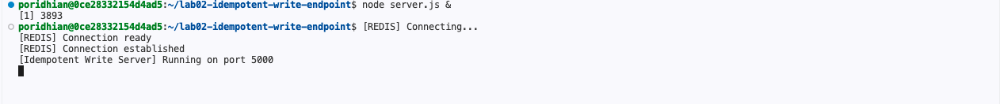
</p>

**Expected output:**

```text
[REDIS] Connecting...
[REDIS] Connection ready
[REDIS] Connection established
[Idempotent Write Server] Running on port 5000
```

Retrieve the private IP address of your virtual machine:

```bash
hostname -I | awk '{print $1}'
```

<p align="center">
  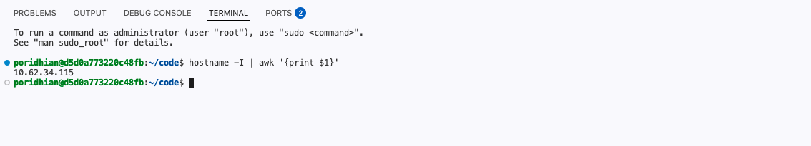
</p>

Configure the Poridhi Load Balancer:

1. Open the **Load Balancer** modal in the Poridhi interface.
2. Enter the IP address obtained from `hostname -I` in the **Enter IP** field.
3. Enter **5000** in the **Enter Port** field.
4. Click **Expose** to generate an active public URL.

<p align="center">
  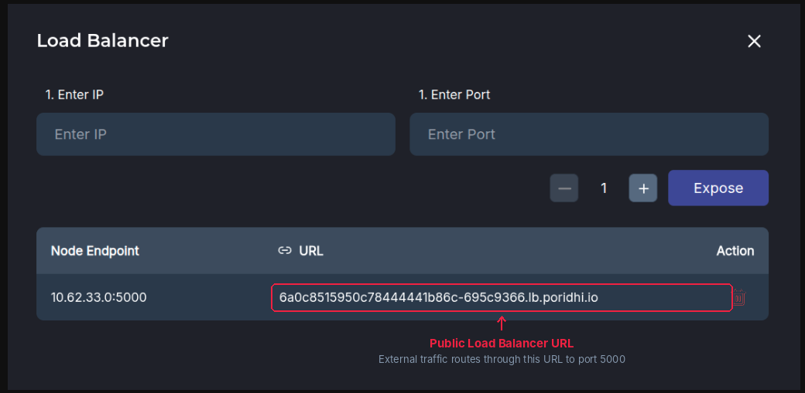
</p>

Open the generated Load Balancer URL in your web browser to confirm connectivity:

<p align="center">
  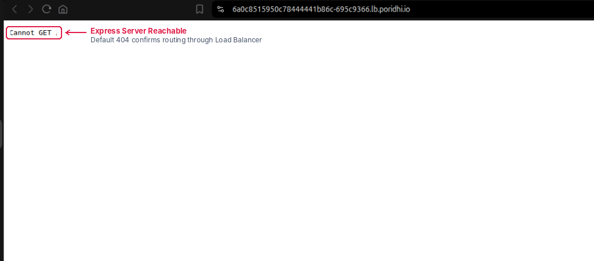
</p>

---

## Verification

You will verify cache miss behavior, duplicate request replay, database record counts, and concurrency protection using `curl` and the automated test runner.

In these tests, compare both the HTTP status and response headers. They show whether the server created an order or replayed a previously saved result.

### Scenario 1: Primary Mutation (Cache Miss, Expected 201 Created)

**What are we testing?** This is the first request with this key. Redis has no record, so the middleware acquires a lock, lets the route create the order, and saves the successful response. Look for `X-Cache: MISS`.

Submit an initial order request with `Idempotency-Key: ord_tx_1001`:

```bash
curl -i -X POST http://localhost:5000/api/v1/orders \
  -H "Content-Type: application/json" \
  -H "Idempotency-Key: ord_tx_1001" \
  -d '{"amount": 250.00, "description": "Mechanical Keyboard"}'
```

<p align="center">
  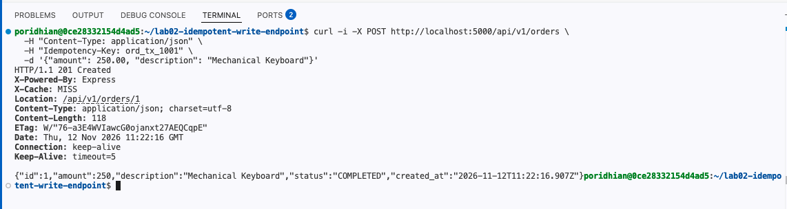
</p>

**Expected output:**

```text
HTTP/1.1 201 Created
X-Cache: MISS
Location: /api/v1/orders/1
Content-Type: application/json; charset=utf-8

{
  "id": 1,
  "amount": 250,
  "description": "Mechanical Keyboard",
  "status": "COMPLETED",
  "created_at": "2026-11-07T05:13:20.119Z"
}
```

> **What to Observe:** The server returns `X-Cache: MISS` and generates a newly committed order with ID 1 alongside a `Location: /api/v1/orders/1` header.

---

### Scenario 2: Identical Network Retry (Cache Hit, Expected 201 Created Replay)

**What are we testing?** Send the same logical request again with the same key. The middleware should return the saved response without creating another order. Look for `X-Cache: HIT` and `Idempotency-Replay: true`.

Execute the exact same request again with the identical `Idempotency-Key`:

```bash
curl -i -X POST http://localhost:5000/api/v1/orders \
  -H "Content-Type: application/json" \
  -H "Idempotency-Key: ord_tx_1001" \
  -d '{"amount": 250.00, "description": "Mechanical Keyboard"}'
```

<p align="center">
  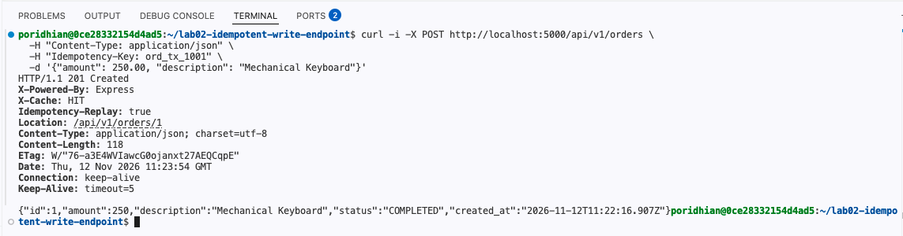
</p>

**Expected output:**

```text
HTTP/1.1 201 Created
X-Cache: HIT
Idempotency-Replay: true
Location: /api/v1/orders/1
Content-Type: application/json; charset=utf-8

{
  "id": 1,
  "amount": 250,
  "description": "Mechanical Keyboard",
  "status": "COMPLETED",
  "created_at": "2026-11-07T05:13:20.119Z"
}
```

> **What to Observe:** The response headers show `X-Cache: HIT` and `Idempotency-Replay: true`. The returned payload and `Location` header are byte-identical to Scenario 1, including the original `created_at` timestamp.

---

### Scenario 3: Verify Persistent Database State

**What are we testing?** The order count should remain one after the retry. The second request should replay the first response, not create another order. This is the check that turns "the headers look right" into "there is provably only one effect".

Query the orders collection to verify that only a single order exists:

```bash
curl -s http://localhost:5000/api/v1/orders | jq .
```

<p align="center">
  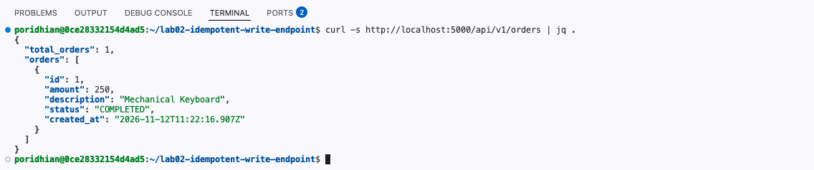
</p>

**Expected output:**

```json
{
  "total_orders": 1,
  "orders": [
    {
      "id": 1,
      "amount": 250,
      "description": "Mechanical Keyboard",
      "status": "COMPLETED",
      "created_at": "2026-11-07T05:13:20.119Z"
    }
  ]
}
```

> **What to Observe:** Despite submitting two identical requests, `total_orders` remains 1. The second request was replayed from Redis without touching the database.

---

### Scenario 4: Automated Concurrency and Idempotency Test Suite

**What are we testing?** Instead of manually running each request, `test-idempotency.js` sends requests automatically and checks their status codes and response data. It is the formal proof of the lab's deliverable: duplicate requests produce one effect.

**What is concurrency?** It means multiple requests happen at nearly the same time. Both requests in this test use the same key. The Redis lock should let one proceed and cause the other to receive 409 Conflict.

This test file sends HTTP requests using JavaScript, so you do not need to type every test request manually. It checks missing-key behavior, the first successful write, retry replay, the persisted record count, and two simultaneous requests using the same key.

Create a file named `test-idempotency.js` with the following contents:

```javascript
const http = require('http');
const { app, redis, waitForRedis } = require('./server');

async function runSuite() {
  // Wait for Redis before listening: the client is created with
  // enableOfflineQueue: false, so any command sent while the socket is
  // still connecting is rejected instead of being queued.
  await waitForRedis();

  const server = app.listen(0, async () => {
    const port = server.address().port;
    const baseUrl = `http://localhost:${port}`;
    console.log(`[TEST SUITE] Starting Idempotency Test on port ${port}...\n`);

    function request(method, path, headers = {}, body = null) {
      return new Promise((resolve, reject) => {
        const url = new URL(path, baseUrl);
        const req = http.request(
          url,
          {
            method,
            headers: { 'Content-Type': 'application/json', ...headers }
          },
          (res) => {
            let data = '';
            res.on('data', (chunk) => (data += chunk));
            res.on('end', () => {
              let parsed = null;
              try {
                parsed = JSON.parse(data);
              } catch (e) {
                parsed = data;
              }
              resolve({ status: res.statusCode, headers: res.headers, body: parsed });
            });
          }
        );
        req.on('error', reject);
        if (body) req.write(JSON.stringify(body));
        req.end();
      });
    }

    try {
      // 0. Reset state with admin header
      await request('POST', '/api/v1/reset', { 'X-Admin-Reset': 'true' });

      // Test 1: Missing Idempotency-Key
      console.log('Test 1: Calling POST /api/v1/orders without Idempotency-Key header...');
      const r1 = await request('POST', '/api/v1/orders', {}, { amount: 100 });
      if (r1.status === 400) {
        console.log('  PASS: 400 Bad Request returned for missing header.\n');
      } else {
        throw new Error(`Test 1 Failed: Status was ${r1.status}`);
      }

      // Test 2: First Write with Idempotency-Key
      const testKey1 = 'pay_test_uuid_001';
      console.log(`Test 2: Primary Request with Idempotency-Key="${testKey1}"...`);
      const r2 = await request(
        'POST',
        '/api/v1/orders',
        { 'Idempotency-Key': testKey1 },
        { amount: 250, description: 'Laptop Purchase' }
      );
      if (
        r2.status === 201 &&
        r2.headers['x-cache'] === 'MISS' &&
        r2.body.id === 1 &&
        r2.headers.location
      ) {
        console.log(`  PASS: 201 Created, X-Cache: MISS. Order ID: 1, Amount: $${r2.body.amount}\n`);
      } else {
        throw new Error(`Test 2 Failed: Status ${r2.status}, Cache ${r2.headers['x-cache']}`);
      }

      // Test 3: Exact Retry with same Idempotency-Key
      console.log(`Test 3: Simulating Network Retry with identical Idempotency-Key="${testKey1}"...`);
      const r3 = await request(
        'POST',
        '/api/v1/orders',
        { 'Idempotency-Key': testKey1 },
        { amount: 250, description: 'Laptop Purchase' }
      );
      if (
        r3.status === 201 &&
        r3.headers['x-cache'] === 'HIT' &&
        r3.body.id === 1 &&
        r3.headers.location
      ) {
        console.log(`  PASS: 201 Created Replayed from Redis Cache (X-Cache: HIT). Returned same Order ID: 1`);
      } else {
        throw new Error(`Test 3 Failed: Status ${r3.status}, Cache ${r3.headers['x-cache']}`);
      }

      // Verify Database Count
      const dbState1 = await request('GET', '/api/v1/orders');
      console.log(`Verifying persistent database state: Total orders stored = ${dbState1.body.total_orders}`);
      if (dbState1.body.total_orders === 1) {
        console.log('  PASS: Exactly ONE order created in database despite multiple retries!\n');
      } else {
        throw new Error(`Expected 1 order in DB, found ${dbState1.body.total_orders}`);
      }

      // Test 4: Concurrent Race Condition with same key (H-01 Fixed Strict Assertion)
      const raceKey = 'pay_race_uuid_002';
      console.log(`Test 4: Simulating 2 Concurrent Parallel POST requests with Idempotency-Key="${raceKey}"...`);
      const [p1, p2] = await Promise.all([
        request(
          'POST',
          '/api/v1/orders',
          { 'Idempotency-Key': raceKey },
          { amount: 500, description: 'Parallel 1' }
        ),
        request(
          'POST',
          '/api/v1/orders',
          { 'Idempotency-Key': raceKey },
          { amount: 500, description: 'Parallel 2' }
        )
      ]);

      const statuses = [p1.status, p2.status].sort();
      console.log(`Received concurrent statuses: ${p1.status} and ${p2.status}`);
      // Strict mutual exclusion verification: exactly one 201 and one 409
      if (statuses[0] === 201 && statuses[1] === 409) {
        console.log('  PASS: Mutual exclusion preserved. No double-order race condition!');
      } else {
        throw new Error(
          `Concurrent test failed: Expected [201, 409] but received ${JSON.stringify(statuses)}`
        );
      }

      const dbState2 = await request('GET', '/api/v1/orders');
      console.log(`Total orders in DB after concurrent requests: ${dbState2.body.total_orders}`);
      if (dbState2.body.total_orders === 2) {
        console.log('  PASS: Correct total order count confirmed in database.\n');
      } else {
        throw new Error(`Expected 2 orders, found ${dbState2.body.total_orders}`);
      }

      console.log('  ALL IDEMPOTENT WRITE TESTS PASSED SUCCESSFULLY!');
    } catch (err) {
      console.error('Test suite failed:', err);
      process.exitCode = 1;
    } finally {
      server.close();
      await redis.quit();
    }
  });
}

runSuite().catch((err) => {
  console.error('Test suite failed to start:', err);
  process.exitCode = 1;
});
```

**Explanation:**

- `app.listen(0)` — executes the server on a dynamic port to avoid collisions with the background process on port 5000.
- **Test 1** — asserts that omitting `Idempotency-Key` triggers an immediate HTTP 400 Bad Request.
- **Test 2** — asserts that an initial write produces HTTP 201 Created with header `X-Cache: MISS` and sets a valid `Location` header.
- **Test 3** — asserts that a duplicate write request returns HTTP 201 Created with `X-Cache: HIT`, identical order data, and replayed `Location` header.
- **Database count assertion** — checks that `total_orders` equals 1 after the retry. This is the assertion that proves a duplicate produced no second effect.
- **Test 4** — uses `Promise.all` to launch concurrent parallel requests sharing the same key, strictly asserting that one gets 201 and the other gets 409 (`statuses[0] === 201 && statuses[1] === 409`), eliminating the possibility of undetected double-writes.
- `redis.quit()` — closes the Redis connection so the test process can exit cleanly.

The test script uses `if` statements to compare actual results with expected results. If a check fails, the script throws an error. If every check passes, it prints the success message.

Execute the automated test suite:

```bash
npm test
```

<p align="center">
  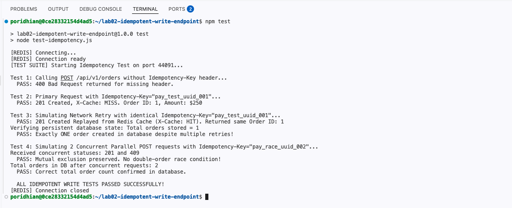
</p>

**Expected output:**

```text
> lab02-idempotent-write-endpoint@1.0.0 test
> node test-idempotency.js

[REDIS] Connecting...
[REDIS] Connection ready
[TEST SUITE] Starting Idempotency Test on port 44115...

Test 1: Calling POST /api/v1/orders without Idempotency-Key header...
  PASS: 400 Bad Request returned for missing header.

Test 2: Primary Request with Idempotency-Key="pay_test_uuid_001"...
  PASS: 201 Created, X-Cache: MISS. Order ID: 1, Amount: $250

Test 3: Simulating Network Retry with identical Idempotency-Key="pay_test_uuid_001"...
  PASS: 201 Created Replayed from Redis Cache (X-Cache: HIT). Returned same Order ID: 1
Verifying persistent database state: Total orders stored = 1
  PASS: Exactly ONE order created in database despite multiple retries!

Test 4: Simulating 2 Concurrent Parallel POST requests with Idempotency-Key="pay_race_uuid_002"...
Received concurrent statuses: 201 and 409
  PASS: Mutual exclusion preserved. No double-order race condition!
Total orders in DB after concurrent requests: 2
  PASS: Correct total order count confirmed in database.

  ALL IDEMPOTENT WRITE TESTS PASSED SUCCESSFULLY!
```

> **What to Observe:** The suite proves both halves of the deliverable. The retry case shows `total_orders` is 1 after two identical requests, and the concurrent case shows statuses of exactly 201 and 409 with `total_orders` at 2 after two parallel requests.

---

### Scenario 5: A Failed Request Does Not Poison the Key

**What are we testing?** If a write fails validation, the lock must be released. Otherwise the client would be locked out of its own key for 24 hours and could never correct its mistake.

Send an invalid order using a fresh key:

```bash
curl -i -X POST http://localhost:5000/api/v1/orders \
  -H "Content-Type: application/json" \
  -H "Idempotency-Key: ord_bad_2001" \
  -d '{"amount": -5, "description": "Negative Amount"}'
```

<p align="center">
  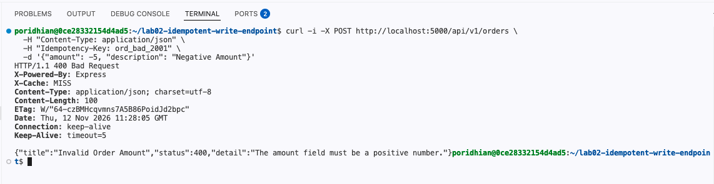
</p>

**Expected output:**

```text
HTTP/1.1 400 Bad Request
X-Cache: MISS
Content-Type: application/json; charset=utf-8

{"title":"Invalid Order Amount","status":400,"detail":"The amount field must be a positive number."}
```

Now reuse that same key with a corrected body:

```bash
curl -i -X POST http://localhost:5000/api/v1/orders \
  -H "Content-Type: application/json" \
  -H "Idempotency-Key: ord_bad_2001" \
  -d '{"amount": 42.00, "description": "Corrected Order"}'
```

<p align="center">
  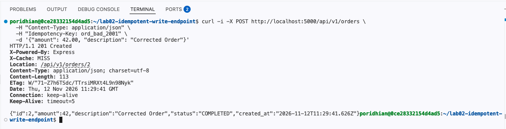
</p>

**Expected output:**

```text
HTTP/1.1 201 Created
X-Cache: MISS
Location: /api/v1/orders/2
Content-Type: application/json; charset=utf-8

{"id":2,"amount":42,"description":"Corrected Order","status":"COMPLETED","created_at":"2026-11-12T11:29:41.626Z"}
```

> **What to Observe:** The second request returns `201 Created` with `X-Cache: MISS`, not `409 Conflict`. The 400 released the lock, so the same key was free to be used again.

---

## Troubleshooting

When something fails, first identify which part is affected: the Node.js server, the Redis container, or the load balancer connection. Then compare the error with the table below.

| Issue | Cause | Solution |
| :--- | :--- | :--- |
| `Error: listen EADDRINUSE :::5000` | Port 5000 is still bound by Lab 01 or a background server. | Run `pkill -f "node server.js"` or `lsof -i :5000` and kill the associated PID. |
| `ConnectionRefusedError: connect ECONNREFUSED 127.0.0.1:6379` | The Redis container is not running or still initializing. | Check container status with `docker compose ps` and logs with `docker compose logs redis`. |
| `HTTP 503 Service Unavailable` | Redis is unreachable during a write operation. | This is expected fail-closed behavior to protect against duplicate writes. Ensure Redis is healthy with `docker compose exec redis redis-cli ping`. |
| `Error response from daemon: port is already allocated` | Another process already holds port 6379. | Run `lsof -i :6379` to find the PID and stop it, then run `docker compose up -d redis` again. |
| `docker: command not found` | Docker is not installed or not running in the VM. | Verify with `docker --version` and start the Docker service before continuing. |
| `npm ERR! Cannot find module 'ioredis'` | Dependencies were not installed, or the server was started from a different directory. | Run `npm install` inside `~/lab02-idempotent-write-endpoint` and start the server from that same directory. |
| Test suite prints `Test suite failed: Test 1 Failed: Status was 201` | A stale Redis lock from a previous run is still present. | Run `docker compose exec redis redis-cli FLUSHALL`, then run `npm test` again. |

---

## Teardown & Cleanup

Stop the background Node.js process and remove the Redis container after testing. This avoids port conflicts and keeps the next lab's environment clean.

When you have finished testing this lab, stop the server process and take down the Redis container before starting subsequent labs:

```bash
# Stop background Node.js server
pkill -f "node server.js" || true

# Stop and remove Redis container and volumes
docker compose down -v
```

<p align="center">
  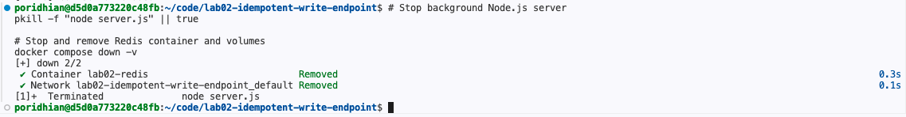
</p>

**Expected output:**

```text
[+] Running 2/2
 ✔ Container lab02-redis                Removed
 ✔ Network lab02-idempotent-write-endpoint_default  Removed
```

---

## Conclusion

You built an idempotency-protected write endpoint using Express and Redis 7. You implemented atomic mutual exclusion locks with `SETNX`, intermediate conflict rejection with 409 Conflict, selective 2xx caching, key-poisoning defense on failure, and fail-closed safety with 503 under Redis outages. You proved with an automated test that duplicate retries create exactly one order and that concurrent requests with the same key yield exactly one 201 and one 409, so the client can retry a failed payment without being charged twice.
