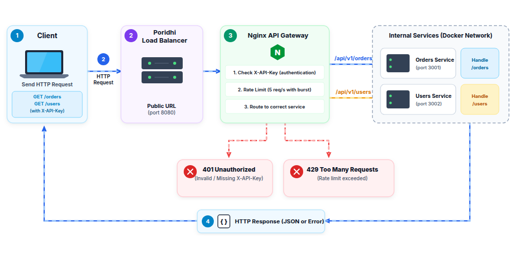
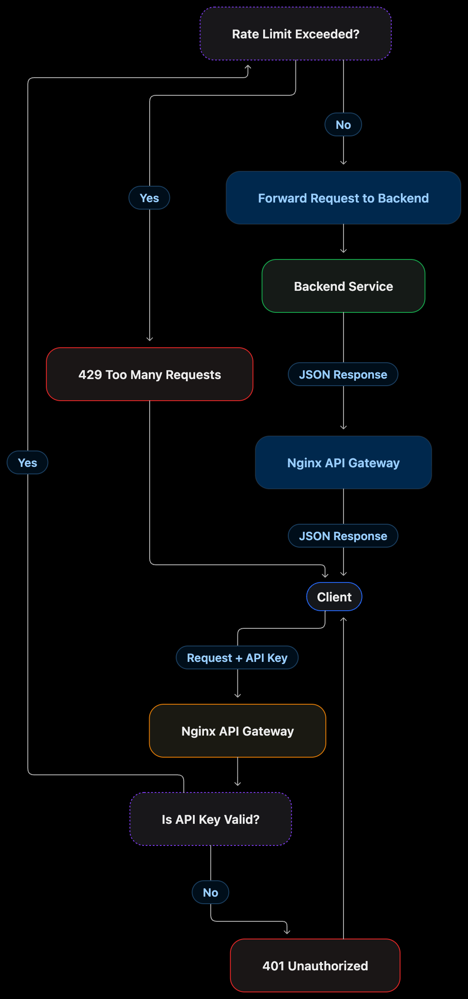
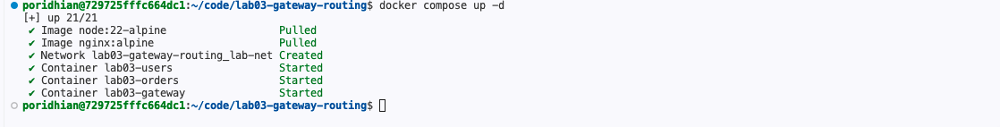
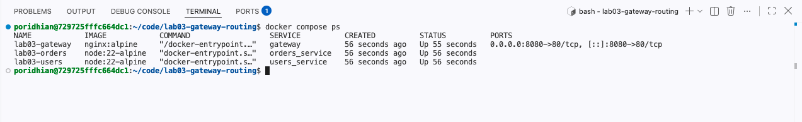
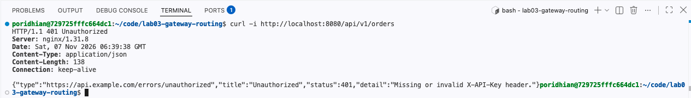
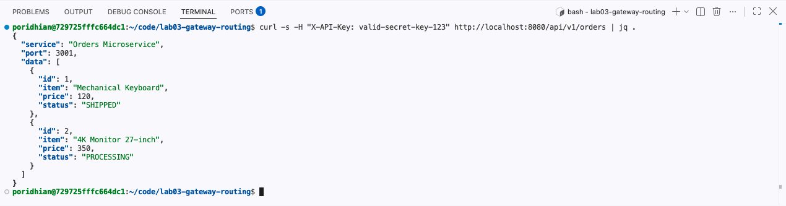
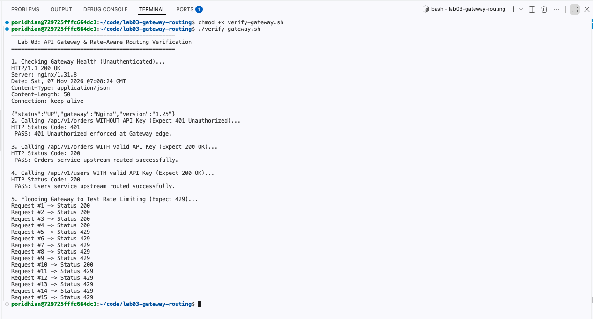

# Lab 03 — Nginx API Gateway with Authentication, Rate Limiting and Routing

## Lab Overview

This lab builds an API Gateway using Nginx that sits between clients and two backend microservices: orders-service (order requests) and users-service (user requests). All requests pass through Nginx, which performs three jobs: authentication, rate limiting, and request routing.

Clients never talk to the backend services directly. Nginx is the single entry point.



## What happens when a client sends a request

The client sends a request to the gateway with an API key.

Nginx checks whether the API key is valid.

If the key is invalid or missing, Nginx returns 401 Unauthorized.

If the key is valid, Nginx checks the client's request rate.

If the request exceeds the allowed rate, Nginx returns 429 Too Many Requests.

Otherwise, Nginx forwards the request to the correct backend service.

The service returns JSON data through Nginx to the client.

## Architecture

Each component has one job, and only the gateway is reachable from the host.

| Component | Responsibility |
|---|---|
| Client | Sends API requests to the gateway. |
| Nginx Gateway | Authenticates, rate-limits and routes requests. |
| Orders Service | Handles order requests on port 3001. |
| Users Service | Handles user requests on port 3002. |
| Docker Network | Lets containers talk to each other privately. |

### Request flow



### How rate limiting works

Nginx's limit_req module uses the leaky bucket algorithm to regulate incoming requests.

- **Allowed rate**: 5 requests per second
- **Burst allowance**: 5 requests
- **nodelay**: excess requests inside the burst allowance are forwarded immediately instead of queueing.

Think of it as a queue with a controlled processing rate: requests drip out at 5 per second, and anything beyond that is rejected with 429. The burst permits temporary spikes, but it does not raise the sustained rate above 5 requests per second.

## Prerequisites

Check every tool before you start.

| Tool | Purpose | Verification |
|---|---|---|
| Node.js v20 or v22 | Runs the backend applications. | `node -v` |
| Docker Engine v24+ | Runs applications inside containers. | `docker --version` |
| Docker Compose v2+ | Manages multiple containers together. | `docker compose version` |
| cURL | Sends HTTP requests for testing. | `curl --version` |
| jq | Formats JSON responses. | `jq --version` |

**Port requirement**: host port 8080 must be free.

> **Note:** Lab 03 and Lab 04 both use port 8080. Stop containers from previous labs first: `docker compose down -v`

## Concepts You Should Understand

These concepts underpin every step in the lab.

| Concept | Beginner-friendly explanation |
|---|---|
| API Gateway | A single entry point that receives client requests and forwards them to the right backend. |
| Reverse Proxy | A server that receives requests on behalf of another server and forwards them. |
| Authentication | Checking whether a client may access an API using valid credentials. |
| API Key | A secret value sent by a client to prove it is an authorised API consumer. |
| Rate Limiting | Restricting how frequently a client can send requests. |
| Upstream | A group or definition of backend servers Nginx can forward requests to. |
| Nginx map | Creates a mapping between an input value and an output value. |
| Docker Bridge Network | A private network that lets containers communicate with each other. |
| Container Port | The port an application listens on inside its container. |
| Port Mapping | Connects a host machine port to a container port. |

## Objectives

By the end of this lab, you will be able to:

- Create two independent Node.js microservices.
- Understand how Nginx works as an API Gateway and reverse proxy.
- Configure API key authentication using Nginx `map`.
- Apply rate limiting using `limit_req_zone` and `limit_req`.
- Connect multiple containers using a private Docker bridge network.
- Route requests dynamically based on URL paths.
- Test authentication, routing and rate limiting using cURL.

## Project Structure

You will create six files across four directories.

```text
lab03-gateway-routing/
├── docker-compose.yml
├── nginx.conf
├── services/
│   ├── orders-service/
│   │   ├── package.json
│   │   └── server.js
│   └── users-service/
│       ├── package.json
│       └── server.js
└── verify-gateway.sh
```

| File | Purpose |
|---|---|
| docker-compose.yml | Defines and runs all three containers. |
| nginx.conf | Configures authentication, rate limiting and request routing. |
| orders-service/server.js | Implements the Orders API. |
| users-service/server.js | Implements the Users API. |
| package.json | Defines dependencies and the start command for each service. |
| verify-gateway.sh | Automatically tests the gateway functionality. |

---

## Step 1 — Create the Node.js Microservices

Two independent Node.js applications sit behind the gateway. Splitting orders from users is the basic idea behind microservices architecture: one service manages customer orders, another manages customer information.

### 1.1 Create the project directories

```bash
mkdir -p ~/lab03-gateway-routing/services/orders-service
mkdir -p ~/lab03-gateway-routing/services/users-service
cd ~/lab03-gateway-routing
```

`mkdir` creates a directory and `-p` creates parent directories if needed. `cd` moves into the project directory.

### 1.2 Create the Orders Service

```bash
cd services/orders-service
```

Create `package.json`:

```json
{
  "name": "orders-service",
  "version": "1.0.0",
  "main": "server.js",
  "scripts": {
    "start": "node server.js"
  },
  "dependencies": {
    "express": "^4.18.2"
  }
}
```

Create `server.js`:

```javascript
const express = require('express');
const app = express();

app.use(express.json());

const orders = [
  { id: 1, customer: 'Alice', item: 'Laptop', total: 1299.99, status: 'shipped' },
  { id: 2, customer: 'Bob', item: 'Phone', total: 799.99, status: 'processing' },
  { id: 3, customer: 'Charlie', item: 'Tablet', total: 499.99, status: 'delivered' }
];

app.get('/health', (req, res) => {
  res.json({ service: 'orders-service', status: 'healthy' });
});

app.get('/orders', (req, res) => {
  res.json({ service: 'orders-service', count: orders.length, data: orders });
});

app.get('/orders/:id', (req, res) => {
  const order = orders.find(o => o.id === Number(req.params.id));
  if (!order) {
    return res.status(404).json({ service: 'orders-service', error: 'Order not found' });
  }
  res.json({ service: 'orders-service', data: order });
});

app.post('/orders', (req, res) => {
  const newOrder = { id: orders.length + 1, status: 'created', ...req.body };
  orders.push(newOrder);
  res.status(201).json({ service: 'orders-service', data: newOrder });
});

const PORT = process.env.PORT || 3001;

app.listen(PORT, '0.0.0.0', () => {
  console.log(`Orders service listening on port ${PORT}`);
});
```

### 1.3 Create the Users Service

```bash
cd ../users-service
```

Create `package.json`:

```json
{
  "name": "users-service",
  "version": "1.0.0",
  "main": "server.js",
  "scripts": {
    "start": "node server.js"
  },
  "dependencies": {
    "express": "^4.18.2"
  }
}
```

Create `server.js`:

```javascript
const express = require('express');
const app = express();

app.use(express.json());

const users = [
  { id: 1, name: 'Alice', email: 'alice@example.com', role: 'customer' },
  { id: 2, name: 'Bob', email: 'bob@example.com', role: 'admin' },
  { id: 3, name: 'Charlie', email: 'charlie@example.com', role: 'customer' }
];

app.get('/health', (req, res) => {
  res.json({ service: 'users-service', status: 'healthy' });
});

app.get('/users', (req, res) => {
  res.json({ service: 'users-service', count: users.length, data: users });
});

app.get('/users/:id', (req, res) => {
  const user = users.find(u => u.id === Number(req.params.id));
  if (!user) {
    return res.status(404).json({ service: 'users-service', error: 'User not found' });
  }
  res.json({ service: 'users-service', data: user });
});

app.post('/users', (req, res) => {
  const newUser = { id: users.length + 1, ...req.body };
  users.push(newUser);
  res.status(201).json({ service: 'users-service', data: newUser });
});

const PORT = process.env.PORT || 3002;

app.listen(PORT, '0.0.0.0', () => {
  console.log(`Users service listening on port ${PORT}`);
});
```

Return to the project root:

```bash
cd ~/lab03-gateway-routing
```

---

## Step 2 — Configure the Nginx API Gateway

The gateway config combines three mechanisms: `map` for authentication, `limit_req_zone` for rate limiting, and `location` blocks for routing.

Create `nginx.conf` in the project root:

```nginx
worker_processes auto;

events {
  worker_connections 1024;
}

http {
  # Map the incoming API key to an authorisation status.
  # 1 = valid key, 0 = invalid or missing key.
  map $http_x_api_key $api_key_status {
    default 0;
    "lab03-valid-key" 1;
  }

  # Rate-limit zone keyed by the client's IP address.
  # 5 requests per second, burst of 5 requests.
  limit_req_zone $binary_remote_addr zone=api_limit:10m rate=5r/s;

  # Upstream definitions for the two backend services.
  upstream orders_service {
    server orders-service:3001;
  }

  upstream users_service {
    server users-service:3002;
  }

  server {
    listen 80;
    server_name _;

    # --- Authentication ---
    # Reject any request without a valid API key.
    if ($api_key_status = 0) {
      return 401 '{"error":"Unauthorized","message":"Invalid or missing API key"}';
    }

    # --- Rate limiting ---
    # nodelay forwards burst requests immediately instead of queueing them.
    limit_req zone=api_limit burst=5 nodelay;
    limit_req_status 429;

    # --- Routing ---
    location /orders {
      proxy_pass http://orders_service;
      proxy_set_header Host $host;
      proxy_set_header X-API-Key $http_x_api_key;
      proxy_set_header X-Real-IP $remote_addr;
      proxy_set_header X-Forwarded-For $proxy_add_x_forwarded_for;
      proxy_set_header X-Forwarded-Proto $scheme;
    }

    location /users {
      proxy_pass http://users_service;
      proxy_set_header Host $host;
      proxy_set_header X-API-Key $http_x_api_key;
      proxy_set_header X-Real-IP $remote_addr;
      proxy_set_header X-Forwarded-For $proxy_add_x_forwarded_for;
      proxy_set_header X-Forwarded-Proto $scheme;
    }

    location = /health {
      proxy_pass http://orders_service/health;
      proxy_set_header Host $host;
    }

    # Any other path has no backend.
    location / {
      return 404 '{"error":"Not Found","message":"Unknown endpoint"}';
    }
  }
}
```

### How the config works

| Directive | Purpose |
|---|---|
| `map $http_x_api_key $api_key_status` | Turns the X-API-Key header into 1 (valid) or 0 (invalid). |
| `if ($api_key_status = 0)` | Returns 401 before any request reaches a backend. |
| `limit_req_zone` | Defines the shared-memory zone and the 5r/s rate. |
| `limit_req zone=api_limit burst=5 nodelay` | Applies the limit with a burst of 5 and no queueing delay. |
| `limit_req_status 429` | Returns 429 instead of the default 503 when a request is rejected. |
| `upstream` | Names a backend server group Nginx can proxy to. |
| `proxy_pass` | Forwards the request to the matching upstream. |

> **Note:** `orders-service:3001` is a Docker network service name, not localhost. Inside the Nginx container, localhost means the Nginx container itself.

---

## Step 3 — Docker Compose Configuration

Compose defines three containers on one private bridge network. Only the gateway publishes a host port.

Create `docker-compose.yml`:

```yaml
services:
  orders-service:
    build: ./services/orders-service
    container_name: orders-service
    environment:
      PORT: "3001"
    networks:
      - gateway-network
    restart: unless-stopped

  users-service:
    build: ./services/users-service
    container_name: users-service
    environment:
      PORT: "3002"
    networks:
      - gateway-network
    restart: unless-stopped

  gateway:
    image: nginx:1.25-alpine
    container_name: api-gateway
    volumes:
      - ./nginx.conf:/etc/nginx/nginx.conf:ro
    ports:
      - "8080:80"
    depends_on:
      - orders-service
      - users-service
    networks:
      - gateway-network
    restart: unless-stopped

networks:
  gateway-network:
    driver: bridge
```

### Key points

Each service gets its own Dockerfile build context, so add one to each service directory:

`services/orders-service/Dockerfile`:

```dockerfile
FROM node:20-alpine
WORKDIR /app
COPY package*.json ./
RUN npm install --omit=dev
COPY . .
EXPOSE 3001
CMD ["npm", "start"]
```

`services/users-service/Dockerfile`:

```dockerfile
FROM node:20-alpine
WORKDIR /app
COPY package*.json ./
RUN npm install --omit=dev
COPY . .
EXPOSE 3002
CMD ["npm", "start"]
```

- `ports: "8080:80"` maps host port 8080 to container port 80.
- The backends have no `ports` section, so they are reachable only inside `gateway-network`.
- The `nginx.conf` mount is read-only (`:ro`) so the container cannot modify it.

---

## Step 4 — Verification Script

The script checks authentication, routing and rate limiting in one pass.

Create `verify-gateway.sh`:

```bash
#!/usr/bin/env bash

set -uo pipefail

GATEWAY_URL="${GATEWAY_URL:-http://localhost:8080}"
API_KEY="${API_KEY:-lab03-valid-key}"
PASS=0
FAIL=0

green() { printf "\033[0;32m%s\033[0m\n" "$1"; }
red() { printf "\033[0;31m%s\033[0m\n" "$1"; }
blue() { printf "\033[0;34m%s\033[0m\n" "$1"; }

check_status() {
  local label="$1" expected="$2" actual="$3"
  if [[ "$actual" == "$expected" ]]; then
    green "PASS $label (HTTP $actual)"
    PASS=$((PASS + 1))
  else
    red "FAIL $label (expected $expected, got $actual)"
    FAIL=$((FAIL + 1))
  fi
}

http_code() {
  curl -s -o /dev/null -w "%{http_code}" "$@"
}

blue "==========================================="
blue " Lab 03 Gateway Verification"
blue "==========================================="
echo

# --- Test 1: request without an API key ---
check_status "Missing API key returns 401" 401 \
  "$(http_code "$GATEWAY_URL/orders")"

# --- Test 2: request with an invalid API key ---
check_status "Invalid API key returns 401" 401 \
  "$(http_code -H "X-API-Key: wrong-key" "$GATEWAY_URL/orders")"

# --- Test 3: valid key reaches the orders service ---
check_status "Valid API key routes to orders" 200 \
  "$(http_code -H "X-API-Key: $API_KEY" "$GATEWAY_URL/orders")"

ORDERS_BODY=$(curl -s -H "X-API-Key: $API_KEY" "$GATEWAY_URL/orders")
if echo "$ORDERS_BODY" | jq -e '.service == "orders-service"' >/dev/null 2>&1; then
  green "PASS Orders response comes from orders-service"
  PASS=$((PASS + 1))
else
  red "FAIL Orders response did not come from orders-service"
  FAIL=$((FAIL + 1))
fi

# --- Test 4: valid key reaches the users service ---
check_status "Valid API key routes to users" 200 \
  "$(http_code -H "X-API-Key: $API_KEY" "$GATEWAY_URL/users")"

USERS_BODY=$(curl -s -H "X-API-Key: $API_KEY" "$GATEWAY_URL/users")
if echo "$USERS_BODY" | jq -e '.service == "users-service"' >/dev/null 2>&1; then
  green "PASS Users response comes from users-service"
  PASS=$((PASS + 1))
else
  red "FAIL Users response did not come from users-service"
  FAIL=$((FAIL + 1))
fi

# --- Test 5: single resource routing ---
check_status "Order by id returns 200" 200 \
  "$(http_code -H "X-API-Key: $API_KEY" "$GATEWAY_URL/orders/1")"

check_status "Missing order returns 404" 404 \
  "$(http_code -H "X-API-Key: $API_KEY" "$GATEWAY_URL/orders/9999")"

check_status "Unknown endpoint returns 404" 404 \
  "$(http_code -H "X-API-Key: $API_KEY" "$GATEWAY_URL/unknown")"

# --- Test 6: rate limiting ---
echo
blue "Testing rate limit (20 rapid requests)..."
LIMITED=0
for i in $(seq 1 20); do
  CODE=$(http_code -H "X-API-Key: $API_KEY" "$GATEWAY_URL/orders")
  [[ "$CODE" == "429" ]] && LIMITED=$((LIMITED + 1))
done

if [[ "$LIMITED" -gt 0 ]]; then
  green "PASS Rate limit triggered ($LIMITED of 20 requests returned 429)"
  PASS=$((PASS + 1))
else
  red "FAIL Rate limit never triggered"
  FAIL=$((FAIL + 1))
fi

echo
blue "==========================================="
blue " Passed: $PASS Failed: $FAIL"
blue "==========================================="

[[ "$FAIL" -eq 0 ]] && exit 0 || exit 1
```

Make it executable:

```bash
chmod +x verify-gateway.sh
```

---

## Step 5 — Run and Test the Gateway

Build and start the stack, then confirm every container is healthy.

### 5.1 Build and start

```bash
docker compose build
docker compose up -d
```



Check status:

```bash
docker compose ps
```



All three containers should show Up.

### 5.2 Confirm backend isolation

The backends must not be reachable from the host:

```bash
curl -s http://localhost:3001/orders
curl -s http://localhost:3002/users
```

Both commands should fail to connect. Only port 8080 is published.

### 5.3 Test authentication

Missing API key -> 401

```bash
curl -i http://localhost:8080/orders
```



Valid API key -> 200

```bash
curl -i -H "X-API-Key: lab03-valid-key" http://localhost:8080/orders
```



The first response must contain `"service": "orders-service"`. The second must contain `"service": "users-service"`.

### 5.4 Run the automated verification

```bash
./verify-gateway.sh
```

All tests should print PASS.



---

## Troubleshooting

Work through these symptoms in order.

| Symptom | Likely cause | Fix |
|---|---|---|
| 401 even with the right key | Header name or value mismatch | Check `map` uses `$http_x_api_key` and the exact key string. |
| 502 Bad Gateway | Nginx cannot reach the backend | Check service names and ports match `nginx.conf` and `docker-compose.yml`. |
| 503 instead of 429 | `limit_req_status` not set | Add `limit_req_status 429;` in the `server` block. |
| Connection refused on 8080 | Gateway container not running | Run `docker compose ps` and `docker compose logs gateway`. |
| Rate limit does not trigger | Burst is too large for the request count | Lower `burst` or send more requests in the loop. |
| Backend reachable from host | Port mapping exposed the service | Remove `ports` from the backend services. |
| nginx.conf changes ignored | Config cached in the container | Run `docker compose restart gateway`. |

### Useful diagnostic commands

```bash
docker compose ps
docker compose logs gateway
docker compose logs orders-service
docker compose logs users-service
docker compose exec gateway nginx -t
```

These commands tell you whether the problem lies with Docker, Nginx or a backend application.

---

## Teardown & Cleanup

Stop the containers and remove the network when the lab is done.

```bash
docker compose down -v
```

This stops and removes the containers, removes the Compose-created network, and removes associated named volumes.

Confirm they have stopped:

```bash
docker compose ps
```

The output should be empty. Port 8080 is now free for Lab 04.

---

## Final Review

You built a gateway with three distinct controls.

| Feature | Implementation | Expected result |
|---|---|---|
| API Gateway | Nginx | Single public entry point |
| Authentication | Nginx `map` | 401 for invalid keys |
| Rate limiting | `limit_req_zone` and `limit_req` | 429 when limits are exceeded |
| Request routing | Nginx upstreams | Requests reach the correct service |
| Container isolation | Docker bridge network | Private backend communication |
| Port exposure | Docker Compose | Only the gateway exposes host port 8080 |

### Key Takeaways

Completing this lab taught you seven core ideas:

- An API Gateway provides a centralised entry point for multiple backend services.
- Nginx can authenticate API consumers before requests reach backend applications.
- Rate limiting protects services from excessive incoming traffic.
- Reverse proxying lets Nginx forward requests to different backend services.
- Docker Compose makes it easier to manage multiple containers.
- Docker bridge networks allow private communication between containers.
- Backend services do not need to expose their ports publicly.

### Conclusion
Congratulations! You have built an Nginx API Gateway with authentication, rate limiting and dynamic routing using Docker Compose.
