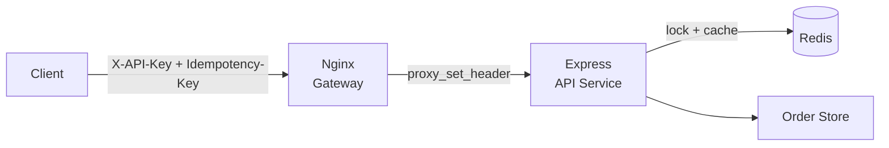

# Lab 04 — Complete API Layer Integration

Module 06 — API Design & Networking Essentials · Lab 4

**Difficulty:** Advanced · **Estimated Time:** 40–50 minutes

---

## Lab Overview

This lab builds a unified API platform from three services wired together with Docker Compose: Nginx as the API gateway (authentication, rate limiting, header forwarding), Express.js as the API service (OpenAPI request validation and business logic), and Redis for distributed idempotency locks and cached responses. You verify the whole system with an automated end-to-end integration test suite.

**The problem we solve.** A customer posts an order, the server creates it, but the response is lost to a network fault. The client cannot tell whether the order was created, so it retries with the same idempotency key. Without protection, the server writes a second order and the customer is charged twice.

```http
POST /api/v1/orders
Idempotency-Key: 550e8400-e29b-41d4-a716-446655440000
X-API-Key: m6_secret_token_123
Content-Type: application/json

{
  "amount": 299.99,
  "description": "Gaming Chair"
}
```

With idempotency, the server recognises the repeated key and replays the original response instead of creating another order.

---

## Objectives

By the end of this lab you will be able to:

- Configure an integrated multi-container Docker Compose architecture connecting Nginx, Express, and Redis
- Implement reverse-proxy header propagation for custom client headers (Idempotency-Key, X-API-Key).
- Ensure selective 2xx caching and fail-closed safety (503) across the idempotency lifecycle.
- Execute an automated end-to-end integration test suite verifying layered defense and idempotency replays.

---

## Prerequisites and Ports

Confirm each tool before you begin.

| Tool | Required version | Verification |
| --- | --- | --- |
| Node.js | v20.x or v22.x LTS | `node -v` |
| Docker | v24+ | `docker --version` |
| Docker Compose | v2+ | `docker compose version` |
| curl | Any recent version | `curl --version` |
| jq | Any recent version | `jq --version` |

**Required host ports**

| Port | Service | Purpose |
| --- | --- | --- |
| 8080 | Nginx | Public API Gateway |
| 6380 | Redis | Optional host access for debugging |

---

## Architecture Overview

The client talks only to Nginx. Nginx secures and shapes traffic, then hands the request to Express. Express validates the contract, coordinates with Redis, and calls the order store.



**Responsibility of each component**

| Component | Responsibility |
| --- | --- |
| Client | Sends API requests with authentication and idempotency headers. |
| Nginx | Authenticates clients and controls request rates. |
| Express | Handles API routes and business logic. |
| OpenAPI | Defines the expected request structure and API behavior. |
| Redis | Stores idempotency locks and successful response data. |
| Order Store | Holds the order records created by the application. |

---

## Core Concepts

A unified API layer splits gateway duties, business logic and distributed coordination across separate components instead of one monolith.

- The gateway handles edge security.
- The API service handles contract validation and business logic.
- Redis handles distributed coordination and response caching.

This separation keeps each component small enough to reason about and scale on its own.

### API gateway

An API gateway is the entry point for incoming requests. Nginx takes on three major tasks:

| Responsibility | Explanation |
| --- | --- |
| Authentication | Checks whether the client has a valid API key. |
| Rate Limiting | Controls how frequently a client can send requests. |
| Header Forwarding | Passes important request headers to the backend. |

### Header propagation

Nginx must explicitly forward the headers Express depends on:

```nginx
proxy_set_header X-API-Key $http_x_api_key;
proxy_set_header Idempotency-Key $http_idempotency_key;
```

Without these directives the backend never receives the authentication or idempotency headers, and every request looks keyless.

### OpenAPI contract

OpenAPI describes how an API should behave. It defines available endpoints, HTTP methods, required headers, request body structure, data types, validation rules and expected responses. For this lab, `amount` must be a number greater than zero:

```yaml
amount:
  type: number
  minimum: 0.01
```

Creating the file does not enforce anything on its own. You must connect the specification to Express through validation code.

### Idempotency

Idempotency ensures that retrying the same operation produces no additional side effect.

| Request | Result |
| --- | --- |
| First request with key A | Creates order 1 |
| Second request with key A | Returns order 1 |
| Third request with key A | Returns order 1 |
| New request with key B | Creates order 2 |

One key represents one logical operation.

### Atomic locking

Before processing a mutation, the service acquires a lock in Redis:

```text
SET idemp:KEY IN_PROGRESS EX 60 NX
```

| Command | Explanation |
| --- | --- |
| `SET` | Store a value in Redis. |
| `idemp:KEY` | Redis key identifying the operation. |
| `IN_PROGRESS` | Indicates that the operation is being processed. |
| `EX 60` | Automatically expires the lock after 60 seconds. |
| `NX` | Only set the key if it does not already exist. |

`SET` with `NX` is a single atomic operation, so two simultaneous requests cannot both win the lock. The `EX` bound stops a crashed process from blocking the key forever.

### Response caching

After a successful mutation, Express stores the status code and response body under the idempotency key for 24 hours. A retry replays that stored response and returns `X-Cache: HIT-IDEMPOTENT`.

---

## Project Structure

Create the project directory and place the files as follows.

```text
module06-lab4/
├── docker-compose.yml
├── nginx/
│   └── nginx.conf
├── api/
│   ├── Dockerfile
│   ├── package.json
│   ├── openapi.yaml
│   ├── src/
│   │   ├── server.js
│   │   ├── app.js
│   │   ├── redis.js
│   │   ├── idempotency.js
│   │   ├── openapi.js
│   │   ├── orderStore.js
│   │   └── routes/
│   │       └── orders.js
│   └── tests/
│       └── integration.test.js
└── .env
```

| Path | Role |
| --- | --- |
| `docker-compose.yml` | Defines and wires the nginx, api and redis services. |
| `nginx/nginx.conf` | Gateway auth, rate limiting and header forwarding. |
| `api/openapi.yaml` | The API contract enforced by Ajv. |
| `api/src/openapi.js` | Loads the contract and builds the validator. |
| `api/src/idempotency.js` | Redis locking, fingerprinting and response replay. |
| `api/src/orderStore.js` | In-memory order records. |
| `api/src/routes/orders.js` | The order endpoints and business logic. |
| `api/tests/integration.test.js` | End-to-end verification suite. |

---

## Step 1 — Docker Compose Configuration

Docker Compose starts all three services on one network, so Nginx reaches Express by service name and Express reaches Redis by service name.

```yaml
services:
  nginx:
    image: nginx:1.27-alpine
    ports:
      - "8080:80"
    volumes:
      - ./nginx/nginx.conf:/etc/nginx/nginx.conf:ro
    depends_on:
      api:
        condition: service_healthy
    networks:
      - apinet
    restart: unless-stopped

  api:
    build: ./api
    environment:
      NODE_ENV: production
      PORT: "3000"
      REDIS_URL: redis://redis:6379
      API_KEY: ${API_KEY:-m6_secret_token_123}
    depends_on:
      redis:
        condition: service_healthy
    networks:
      - apinet
    restart: unless-stopped

  redis:
    image: redis:7-alpine
    command: ["redis-server", "--appendonly", "yes"]
    ports:
      - "6380:6379"
    volumes:
      - redis-data:/data
    healthcheck:
      test: ["CMD", "redis-cli", "ping"]
      interval: 5s
      timeout: 3s
      retries: 5
    networks:
      - apinet
    restart: unless-stopped

networks:
  apinet:
    driver: bridge

volumes:
  redis-data:
```

**Key decisions**

| Choice | Reason |
| --- | --- |
| Service names as hostnames | `api` and `redis` resolve inside the Compose network. |
| Redis healthcheck | The API waits for a healthy Redis before starting. |
| API healthcheck in the Dockerfile | Nginx waits for a healthy API before accepting traffic. |
| Named volume `redis-data` | Keeps cached responses across API restarts. |

---

## Step 2 — Nginx API Gateway Configuration

The Nginx config does three jobs: validate the API key, limit request rate and forward headers.

```nginx
worker_processes auto;

events {
    worker_connections 1024;
}

http {
    include /etc/nginx/mime.types;
    default_type application/json;

    # Shared memory zone for rate-limit counters.
    limit_req_zone $binary_remote_addr zone=api_limit:10m rate=50r/s;
    limit_req_status 429;

    # API keys mapped to client identifiers.
    map $http_x_api_key $api_client_id {
        default        "";
        "m6_secret_token_123"  "client-m6";
    }

    server {
        listen 80;
        server_name _;

        # 1. Health endpoint - no authentication or rate limiting.
        location = /health {
            return 200 '{"status":"ok"}';
        }

        # 2. Reverse proxy to the Express service.
        location /api/ {
            # Authentication at the edge.
            if ($api_client_id = "") {
                return 401 '{"error":{"code":"UNAUTHORIZED","message":"Invalid or missing X-API-Key"}}';
            }

            # Rate limiting per client address.
            limit_req zone=api_limit burst=20 nodelay;

            proxy_pass http://api:3000;
            proxy_http_version 1.1;

            # Forward the headers Express depends on.
            proxy_set_header Host              $host;
            proxy_set_header X-Real-IP         $remote_addr;
            proxy_set_header X-API-Key        $http_x_api_key;
            proxy_set_header Idempotency-Key  $http_idempotency_key;
            proxy_set_header Content-Type     $content_type;

            proxy_connect_timeout 5s;
            proxy_read_timeout 30s;
        }
    }
}
```

**How the pieces work**

- `map` compares the incoming `X-API-Key` against known keys. An unknown or missing key maps to an empty identifier.
- The `if` block returns 401 when the identifier is empty. Nginx `if` inside `location` is safe for this `return` use case.
- `limit_req_zone` allocates shared memory for counters, and `limit_req` applies it with a burst of five and immediate forwarding.
- `proxy_set_header` copies the original header values onto the upstream request.

> **Note:** the authentication `if` and the `limit_req` directive live **inside `location /api/`**, not at the `server` level. An `if` at the `server` level runs during the rewrite phase for *every* request, so it would also block the `location = /health` endpoint with a 401 — and the health check is what tells Compose the gateway is ready.

> **Note:** the limit is set to `rate=50r/s` with `burst=20`. The integration suite in Step 7 issues roughly fourteen requests in quick succession, and a tighter limit (`rate=10r/s` with `burst=5`) rejects everything after the sixth request with a 429 — so the functional tests would fail even though the code is correct. The rate limiter is still clearly observable: the manual check further down fires 30 requests and shows the transition from 400 to 429.

> **Note:** `proxy_pass http://api:3000;` has no URI part, so Nginx forwards the **full original request path** to Express. The client's `/api/v1/orders` therefore arrives unchanged at the Express route of the same name.

---

## Step 3 — OpenAPI Specification

The contract defines the endpoint, its headers, its body schema and every response the client can receive.

```yaml
openapi: 3.0.3
info:
  title: Orders API
  version: 1.0.0
  description: Idempotent order creation for Module 06 Lab 4.

servers:
  - url: /api/v1

paths:
  /orders:
    post:
      summary: Create an order
      operationId: createOrder
      parameters:
        - name: Idempotency-Key
          in: header
          required: true
          description: Unique key identifying one logical order operation.
          schema:
            type: string
            minLength: 8
            maxLength: 128
        - name: X-API-Key
          in: header
          required: true
          description: Gateway-validated API key.
          schema:
            type: string
            minLength: 1
      requestBody:
        required: true
        content:
          application/json:
            schema:
              $ref: '#/components/schemas/CreateOrderRequest'
      responses:
        '201':
          description: Order created.
          headers:
            X-Cache:
              schema:
                type: string
              description: MISS on first write, HIT-IDEMPOTENT on replay.
          content:
            application/json:
              schema:
                $ref: '#/components/schemas/Order'
        '200':
          description: Cached response replayed for a repeated idempotency key.
          content:
            application/json:
              schema:
                $ref: '#/components/schemas/Order'
        '400':
          description: Request failed OpenAPI validation.
        '409':
          description: A request with this idempotency key is already in progress.
        '503':
          description: Redis is unavailable, so writes are refused.

components:
  schemas:
    CreateOrderRequest:
      type: object
      required: [amount, description]
      additionalProperties: false
      properties:
        amount:
          type: number
          minimum: 0.01
          maximum: 1000000
        description:
          type: string
          minLength: 1
          maxLength: 255

    Order:
      type: object
      required: [id, amount, description, status, createdAt]
      properties:
        id:
          type: string
        amount:
          type: number
        description:
          type: string
        status:
          type: string
          enum: [created]
        createdAt:
          type: string
          format: date-time
```

**What each part enforces**

| Contract element | Runtime effect |
| --- | --- |
| Required `Idempotency-Key` header | Requests without it fail validation with 400. |
| Required `X-API-Key` header | Requests without it fail validation with 400. |
| `additionalProperties: false` | Unknown body fields are rejected. |
| `minimum: 0.01` on `amount` | Zero and negative amounts fail validation. |
| `enum: [created]` on `status` | The response shape is fixed. |

---

## Step 4 — Express Service and Middleware

The Express service has four layers: the app wiring, the OpenAPI validator, the idempotency middleware and the route handler.

### api/package.json

```json
{
  "name": "m6-lab4-api",
  "version": "1.0.0",
  "private": true,
  "type": "module",
  "scripts": {
    "start": "node src/server.js",
    "test": "node --test tests/integration.test.js"
  },
  "dependencies": {
    "ajv": "^8.17.1",
    "ajv-formats": "^3.0.1",
    "express": "^4.21.2",
    "js-yaml": "^4.1.0",
    "redis": "^4.7.0"
  }
}
```

### api/src/openapi.js

`api/src/openapi.js` loads the YAML contract and turns it into an Ajv validator.

```javascript
import fs from 'node:fs';
import path from 'node:path';
import { fileURLToPath } from 'node:url';
import Ajv from 'ajv';
import addFormats from 'ajv-formats';
import yaml from 'js-yaml';

const here = path.dirname(fileURLToPath(import.meta.url));
const specPath = path.resolve(here, '..', 'openapi.yaml');

export const openApiSpec = yaml.load(fs.readFileSync(specPath, 'utf8'));

const ajv = new Ajv({ allErrors: true, strict: false });
addFormats(ajv);

const validate = ajv.compile(openApiSpec.components.schemas.CreateOrderRequest);
const validateHeaders = ajv.compile({
  type: 'object',
  required: ['idempotency-key', 'x-api-key'],
  properties: {
    'idempotency-key': {
      type: 'string',
      minLength: 8,
      maxLength: 128
    },
    'x-api-key': { type: 'string', minLength: 1 }
  }
});

export function validateRequest(req) {
  const headersOk = validateHeaders(req.headers);
  const bodyOk = validate(req.body ?? {});

  const errors = [
    ...(validateHeaders.errors ?? []),
    ...(validate.errors ?? [])
  ];

  return { valid: headersOk && bodyOk, errors };
}
```

> **Note:** an Ajv compiled validator returns a **boolean** and exposes the failure details on the function's own `.errors` property. The validator must therefore be called for its return value, and the errors read from `validate.errors` / `validateHeaders.errors` — not from the return value. Writing `const headerResult = validateHeaders(req.headers)` and then reading `headerResult.errors` reads a property off a boolean, which is always `undefined`, so every request would be reported as valid.

### api/src/app.js

`api/src/app.js` assembles the middleware chain.

```javascript
import express from 'express';
import { validateRequest } from './openapi.js';
import { idempotency } from './idempotency.js';
import { orderRouter } from './routes/orders.js';

export function createApp() {
  const app = express();

  app.use(express.json({ limit: '100kb' }));

  app.get('/health', (req, res) => {
    res.json({ status: 'ok' });
  });

  app.post('/api/v1/orders', (req, res, next) => {
    const result = validateRequest(req);

    if (!result.valid) {
      return res.status(400).json({
        error: {
          code: 'VALIDATION_ERROR',
          message: 'Request failed OpenAPI validation',
          details: result.errors
        }
      });
    }

    return next();
  });

  app.use('/api/v1', idempotency, orderRouter);

  app.use((err, req, res, next) => {
    console.error('[api] unhandled error', err);
    res.status(500).json({
      error: { code: 'INTERNAL_ERROR', message: 'Unexpected server error' }
    });
  });

  return app;
}
```

> **Note:** the router is mounted with `app.use('/api/v1', ...)`, not `app.post('/api/v1/orders', ...)`. `app.use` strips the mount prefix and lets the router's own handler path decide the rest, which is what keeps the public route at exactly `/api/v1/orders` with no trailing slash.

### api/src/routes/orders.js

`api/src/routes/orders.js` holds the business logic.

```javascript
import { Router } from 'express';
import crypto from 'node:crypto';
import { orders } from '../orderStore.js';

export const orderRouter = Router({ mergeParams: true });

orderRouter.post('/orders', (req, res) => {
  const order = {
    id: crypto.randomUUID(),
    amount: req.body.amount,
    description: req.body.description,
    status: 'created',
    createdAt: new Date().toISOString()
  };

  orders.push(order);

  res.locals.responseBody = order;

  res.status(201)
    .set('X-Cache', 'MISS')
    .json(order);
});
```

> **Note:** `res.locals.responseBody = order;` is what the idempotency middleware reads back to build the cached payload. Without it the cache would store an empty body and a replay would return nothing.

> **Note:** the router is mounted with `Router({ mergeParams: true })` and its handler path is `'/orders'`. Because `app.js` mounts the router with `app.use('/api/v1', orderRouter)`, the full route becomes `/api/v1/orders`. Mounting the router with `app.post('/api/v1/orders', ..., orderRouter)` and a handler path of `'/'` would instead register the route at `/api/v1/orders/` — with a trailing slash — and every client request to `/api/v1/orders` would return 404.

### api/src/orderStore.js

`api/src/orderStore.js` keeps the records in memory.

```javascript
export const orders = [];
```

### api/src/server.js

`api/src/server.js` starts the HTTP listener and wires Redis.

```javascript
import { createApp } from './app.js';
import { connectRedis, redisClient } from './redis.js';

const port = Number(process.env.PORT ?? 3000);

await connectRedis();

const server = createApp().listen(port, () => {
  console.log(`[api] listening on :${port}`);
});

async function shutdown(signal) {
  console.log(`[api] ${signal} received, shutting down`);
  server.close();
  await redisClient.quit().catch(() => {});
  process.exit(0);
}

process.on('SIGTERM', () => shutdown('SIGTERM'));
process.on('SIGINT', () => shutdown('SIGINT'));
```

> **Note:** `X-Cache: MISS` on the first write and `X-Cache: HIT-IDEMPOTENT` on a replay are the observable signals that idempotency is working. The middleware sets the replay header before it writes the cached response.

---

## Step 5 — Redis Idempotency and Cache

Redis supplies two guarantees the Express service depends on: an atomic lock for in-flight work, and a 24-hour cache of successful responses.

### api/src/redis.js

`api/src/redis.js` owns the connection and exposes readiness.

> **Note:** the readiness check is bounded by a one-second timeout. When Redis goes away, the node-redis client does not reject commands — it queues them while it retries the connection. An unbounded `await redisClient.ping()` therefore hangs until the gateway's `proxy_read_timeout` expires, and the client receives a 504 Gateway Timeout instead of the intended 503 Service Unavailable. Racing the `ping()` against a timer makes the failure surface immediately.

```javascript
import { createClient } from 'redis';

export const redisClient = createClient({
  url: process.env.REDIS_URL ?? 'redis://127.0.0.1:6379',
  socket: {
    connectTimeout: 5000,
    reconnectStrategy: (retries) => Math.min(retries * 100, 3000)
  }
});

redisClient.on('error', (err) => {
  console.error('[redis] client error', err.message);
});

export async function connectRedis() {
  await redisClient.connect();
  console.log('[redis] connected');
}

export async function isRedisReady() {
  try {
    // Bound the check: while the client is reconnecting, node-redis queues
    // the command instead of failing, so an unbounded await would hang until
    // the gateway's read timeout and the client would see a 504 instead of
    // the intended 503.
    const pong = await Promise.race([
      redisClient.ping(),
      new Promise((resolve) => setTimeout(() => resolve(null), 1000))
    ]);
    return pong === 'PONG';
  } catch {
    return false;
  }
}
```

### api/src/idempotency.js

`api/src/idempotency.js` implements the full middleware.

```javascript
import crypto from 'node:crypto';
import { redisClient, isRedisReady } from './redis.js';

const LOCK_TTL_SECONDS = 60;
const CACHE_TTL_SECONDS = 60 * 60 * 24;

const lockKey = (key) => `idemp:lock:${key}`;
const cacheKey = (key) => `idemp:response:${key}`;

function fingerprint(req) {
  return crypto
    .createHash('sha256')
    .update(JSON.stringify({
      method: req.method,
      path: req.path,
      body: req.body ?? {}
    }))
    .digest('hex');
}

export async function idempotency(req, res, next) {
  const key = req.get('Idempotency-Key');

  if (!key) {
    return res.status(400).json({
      error: {
        code: 'IDEMPOTENCY_KEY_REQUIRED',
        message: 'Idempotency-Key header is required'
      }
    });
  }

  // Fail closed: writes require Redis.
  if (!(await isRedisReady())) {
    return res.status(503).json({
      error: {
        code: 'SERVICE_UNAVAILABLE',
        message: 'Idempotency store unavailable, write refused'
      }
    });
  }

  const requestHash = fingerprint(req);

  // 1. Replay a completed response.
  const cachedRaw = await redisClient.get(cacheKey(key));

  if (cachedRaw) {
    const cached = JSON.parse(cachedRaw);

    if (cached.fingerprint !== requestHash) {
      return res.status(422).json({
        error: {
          code: 'IDEMPOTENCY_KEY_REUSE',
          message: 'Idempotency-Key was already used with a different payload'
        }
      });
    }

    return res
      .status(cached.status)
      .set('X-Cache', 'HIT-IDEMPOTENT')
      .set('Idempotency-Replayed', 'true')
      .json(cached.body);
  }

  // 2. Try to acquire the atomic lock.
  const acquired = await redisClient.set(
    lockKey(key),
    JSON.stringify({ fingerprint: requestHash, startedAt: Date.now() }),
    { EX: LOCK_TTL_SECONDS, NX: true }
  );

  if (acquired !== 'OK') {
    // Another request holds the lock for this key.
    return res.status(409).json({
      error: {
        code: 'CONFLICT',
        message: 'A request with this Idempotency-Key is already in progress'
      }
    });
  }

  // 3. Run the business logic, then cache or release the lock.
  try {
    await next();

    const payload = {
      status: res.statusCode,
      body: res.locals.responseBody,
      fingerprint: requestHash,
      cachedAt: new Date().toISOString()
    };

    await redisClient.set(cacheKey(key), JSON.stringify(payload), {
      EX: CACHE_TTL_SECONDS
    });

    await redisClient.del(lockKey(key));
  } catch (err) {
    // Release the lock so a failed attempt can be retried.
    await redisClient.del(lockKey(key)).catch(() => {});
    next(err);
  }
}
```

**How the pieces work**

- `fingerprint` hashes the method, path and body. The same key with a different payload produces a different hash.
- The cache lookup runs first, so a completed operation replays in one Redis round trip.
- `SET ... NX` is atomic. Exactly one concurrent request wins the lock; the rest receive 409.
- The cache stores status, body and fingerprint for 24 hours.
- The `catch` block deletes the lock on failure so a client can retry a request that never completed.

---

## Step 6 — Build and Run the Stack

Build the API image, start the stack and confirm all three containers are healthy.

### api/Dockerfile

```dockerfile
FROM node:20-alpine

WORKDIR /app

COPY package*.json ./
RUN npm install --omit=dev

COPY . .

EXPOSE 3000

HEALTHCHECK --interval=10s --timeout=3s --retries=5 \
  CMD node -e "fetch('http://127.0.0.1:3000/health').then(r=>process.exit(r.ok?0:1)).catch(()=>process.exit(1))"

CMD ["node", "src/server.js"]
```

**Start the stack**

```bash
docker compose up -d --build
```

**Check the services**

```bash
docker compose ps
```

All three services should report healthy.

**Verify the gateway**

```bash
curl -i http://localhost:8080/health
```

**Verify a real order**

```bash
curl -i -X POST http://localhost:8080/api/v1/orders \
  -H "X-API-Key: m6_secret_token_123" \
  -H "Idempotency-Key: 550e8400-e29b-41d4-a716-446655440000" \
  -H "Content-Type: application/json" \
  -d '{"amount":299.99,"description":"Gaming Chair"}'
```

Expected: 201, header `X-Cache: MISS`, and a JSON order object with an `id` and `status: created`.

**Inspect Redis from the host**

```bash
docker compose exec redis redis-cli KEYS 'idemp:*'
```

You should see an `idemp:response:<key>` entry. The matching `idemp:lock:<key>` only exists while a request is in flight — the middleware deletes the lock as soon as the order is created, so it is normally gone by the time you look.

**View logs**

```bash
docker compose logs -f api
docker compose logs -f nginx
```

---

## Step 7 — Integration Test Suite

The test suite runs against the live gateway, so it verifies Nginx, Express and Redis together.

### api/tests/integration.test.js

```javascript
import test from 'node:test';
import assert from 'node:assert/strict';

const BASE_URL = process.env.BASE_URL ?? 'http://nginx';
const API_KEY = process.env.API_KEY ?? 'm6_secret_token_123';

let counter = 0;
const uniqueKey = () => `test-${Date.now()}-${++counter}`;

async function createOrder(key, body = {
  amount: 299.99,
  description: 'Gaming Chair'
}) {
  const res = await fetch(`${BASE_URL}/api/v1/orders`, {
    method: 'POST',
    headers: {
      'X-API-Key': API_KEY,
      'Idempotency-Key': key,
      'Content-Type': 'application/json'
    },
    body: JSON.stringify(body)
  });

  const text = await res.text();
  let json = null;
  try { json = JSON.parse(text); } catch { /* keep null */ }

  return { res, json, text };
}

test('rejects requests without an API key', async () => {
  const res = await fetch(`${BASE_URL}/api/v1/orders`, {
    method: 'POST',
    headers: {
      'Idempotency-Key': uniqueKey(),
      'Content-Type': 'application/json'
    },
    body: JSON.stringify({ amount: 10, description: 'No key' })
  });

  assert.equal(res.status, 401);
});

test('rejects requests with an invalid API key', async () => {
  const res = await fetch(`${BASE_URL}/api/v1/orders`, {
    method: 'POST',
    headers: {
      'X-API-Key': 'wrong_key',
      'Idempotency-Key': uniqueKey(),
      'Content-Type': 'application/json'
    },
    body: JSON.stringify({ amount: 10, description: 'Bad key' })
  });

  assert.equal(res.status, 401);
});

test('rejects a body that violates the OpenAPI contract', async () => {
  const { res } = await createOrder(uniqueKey(), {
    amount: -5,
    description: 'Invalid amount'
  });

  assert.equal(res.status, 400);
});

test('rejects a missing Idempotency-Key header', async () => {
  const res = await fetch(`${BASE_URL}/api/v1/orders`, {
    method: 'POST',
    headers: {
      'X-API-Key': API_KEY,
      'Content-Type': 'application/json'
    },
    body: JSON.stringify({ amount: 10, description: 'Missing key' })
  });

  assert.equal(res.status, 400);
});

test('creates an order and returns X-Cache: MISS on first write', async () => {
  const { res, json } = await createOrder(uniqueKey());

  assert.equal(res.status, 201);
  assert.equal(res.headers.get('x-cache'), 'MISS');
  assert.equal(json.status, 'created');
  assert.ok(json.id);
});

test('replays the cached response for the same idempotency key', async () => {
  const key = uniqueKey();

  const first = await createOrder(key);
  const second = await createOrder(key);

  assert.equal(first.res.status, 201);
  assert.equal(second.res.status, first.res.status);
  assert.equal(second.res.headers.get('x-cache'), 'HIT-IDEMPOTENT');
  assert.deepEqual(second.json, first.json);
});

test('returns 409 when the same key is processed concurrently', async () => {
  const key = uniqueKey();

  const results = await Promise.all([
    createOrder(key),
    createOrder(key),
    createOrder(key)
  ]);

  const created = results.filter(r => r.res.status === 201);
  const conflicted = results.filter(r => r.res.status === 409);

  assert.equal(created.length + conflicted.length, 3);
  assert.ok(created.length >= 1);
});

test('rejects reuse of a key with a different payload', async () => {
  const key = uniqueKey();

  await createOrder(key, { amount: 10, description: 'First payload' });
  const second = await createOrder(key, { amount: 99, description: 'Second payload' });

  assert.equal(second.res.status, 422);
});
```

**Run the suite**

```bash
npm test
```

Or from the host against the running stack:

```bash
docker compose exec api npm test
```

> **Note:** the default `BASE_URL` is `http://nginx`, because the suite runs **inside** the `api` container. Inside the Compose network Nginx listens on its container port `80`, so the service is reachable as `http://nginx` — the `8080:80` mapping only applies to the host. When you run the suite from the host instead, override it:
>
> ```bash
> BASE_URL=http://localhost:8080 npm test
> ```

**What the suite covers**

| Test | Verifies |
| --- | --- |
| Missing and invalid API key | Nginx rejects at the edge with 401. |
| Invalid body | OpenAPI validation returns 400. |
| Missing idempotency key | The contract rejects the request. |
| First write | Returns 201 with `X-Cache: MISS`. |
| Retry with same key | Returns the original status with `X-Cache: HIT-IDEMPOTENT` and an identical body. |
| Concurrent requests | One succeeds, the rest get 409. |
| Key reuse with a new payload | Returns 422. |

---

## Manual Verification with curl

Run these by hand to see each behaviour with your own eyes.

### Missing API key

```bash
curl -i -X POST http://localhost:8080/api/v1/orders \
  -H "Idempotency-Key: demo-missing-auth" \
  -H "Content-Type: application/json" \
  -d '{"amount":10,"description":"No auth"}'
```

Expected: 401 Unauthorized from Nginx.

### First request

```bash
KEY="550e8400-e29b-41d4-a716-446655440000"
curl -i -X POST http://localhost:8080/api/v1/orders \
  -H "X-API-Key: m6_secret_token_123" \
  -H "Idempotency-Key: $KEY" \
  -H "Content-Type: application/json" \
  -d '{"amount":299.99,"description":"Gaming Chair"}'
```

Expected: 201 with `X-Cache: MISS`.

### Retry with the same key and body

```bash
curl -i -X POST http://localhost:8080/api/v1/orders \
  -H "X-API-Key: m6_secret_token_123" \
  -H "Idempotency-Key: $KEY" \
  -H "Content-Type: application/json" \
  -d '{"amount":299.99,"description":"Gaming Chair"}'
```

Expected: the same order id, the same `createdAt`, and `X-Cache: HIT-IDEMPOTENT`. No second order exists.

### Same key, different body

```bash
curl -i -X POST http://localhost:8080/api/v1/orders \
  -H "X-API-Key: m6_secret_token_123" \
  -H "Idempotency-Key: $KEY" \
  -H "Content-Type: application/json" \
  -d '{"amount":1.00,"description":"Different body"}'
```

Expected: 422 with `IDEMPOTENCY_KEY_REUSE`.

### Invalid body

```bash
curl -i -X POST http://localhost:8080/api/v1/orders \
  -H "X-API-Key: m6_secret_token_123" \
  -H "Idempotency-Key: demo-invalid-body" \
  -H "Content-Type: application/json" \
  -d '{"amount":-5,"description":"Negative"}'
```

Expected: 400 with `VALIDATION_ERROR`.

### Concurrent requests with one key

```bash
KEY2="demo-concurrent"
for i in 1 2 3 4 5; do
  curl -s -o /dev/null -w "%{http_code}\n" -X POST http://localhost:8080/api/v1/orders \
    -H "X-API-Key: m6_secret_token_123" \
    -H "Idempotency-Key: $KEY2" \
    -H "Content-Type: application/json" \
    -d '{"amount":50,"description":"Race test"}' &
done
wait
```

Expected: at least one 201, and the requests that arrive while the first one still holds the lock get 409. Because the lock is released as soon as the first order is created, a request that arrives slightly later can succeed too — so you may see more than one 201.

### Rate limiting

```bash
for i in $(seq 1 30); do
  curl -s -o /dev/null -w "%{http_code}\n" \
    -H "X-API-Key: m6_secret_token_123" \
    http://localhost:8080/api/v1/orders
done | sort | uniq -c
```

Expected: mostly 400 from validation (no body) plus some 429 from the rate limiter.

### Inspect Redis

```bash
docker compose exec redis redis-cli KEYS 'idemp:*'
docker compose exec redis redis-cli TTL "idemp:response:$KEY"
```

Expected: the response key has a TTL close to 86,400 seconds.

---

## Failure Mode Handling

The platform is designed to fail in predictable ways.

### Redis unavailable

The service fails closed. Without Redis there is no lock, so a duplicate write becomes possible. The middleware therefore returns 503 Service Unavailable for write operations rather than processing them unsafely.

```bash
docker compose stop redis
curl -i -X POST http://localhost:8080/api/v1/orders \
  -H "X-API-Key: m6_secret_token_123" \
  -H "Idempotency-Key: demo-redis-down" \
  -H "Content-Type: application/json" \
  -d '{"amount":10,"description":"No redis"}'
```

Expected: 503. Restart Redis with `docker compose start redis`.

### Concurrent requests

Two requests with the same key arrive together. Redis `SET NX` lets exactly one acquire the lock. The other sees the key already exists and returns 409 Conflict.

The lock also carries a 60-second TTL. If the API process crashes mid-request, the lock expires on its own and the key becomes usable again.

### Same key, different body

The cached entry stores a fingerprint of the method, path and body. A retry with a different payload produces a different fingerprint, so the service rejects it with 422 Unprocessable Entity rather than replaying an unrelated response.

**Error response catalogue**

| Status | Code | Cause |
| --- | --- | --- |
| 401 | `UNAUTHORIZED` | Missing or invalid `X-API-Key` at Nginx. |
| 400 | `VALIDATION_ERROR` | Body or headers fail the OpenAPI contract. |
| 409 | `CONFLICT` | Another request holds the lock for this key. |
| 422 | `IDEMPOTENCY_KEY_REUSE` | Same key, different payload. |
| 429 | — | Nginx rate limit exceeded. |
| 503 | `SERVICE_UNAVAILABLE` | Redis is unreachable. |

---

## Troubleshooting

### Port 8080 already in use

Another container or process holds the port. Stop the Lab 03 stack with `docker compose down -v` from its directory, then find the holder:

```bash
lsof -i :8080
```

### Nginx returns 502

The API container is not healthy. Check `docker compose ps` and `docker compose logs api`.

### Every request returns 401

The API key does not match the `map` block in `nginx.conf`, or the header was not forwarded. Confirm the header reaches Express:

```bash
docker compose exec api env | grep API_KEY
```

### Every request returns 400 even though the body looks valid

The body validator only checks the `CreateOrderRequest` schema. `additionalProperties: false` rejects unknown fields, so remove any extra properties.

### The replay returns a different order id

The cache is not being read. Check that the cache key format matches in both places:

```bash
docker compose exec redis redis-cli KEYS 'idemp:*'
```

### Every retry returns 409

A lock was left behind, usually from a crashed request. Wait for the 60-second TTL or clear it:

```bash
docker compose exec redis redis-cli --scan --pattern 'idemp:lock:*' | xargs -r docker compose exec redis redis-cli DEL
```

### The rate limiter blocks the test suite

The limit is 50 requests per second with a burst of twenty. If you raise it, or if you run the suite repeatedly in quick succession, the limiter may return 429 instead of the expected status code. Restart the gateway to clear the counters, or raise `rate=` and `burst=` in `nginx.conf`.

### The container restarts in a loop

The API exits when it cannot reach Redis at startup. Confirm `depends_on` with the `healthcheck` condition is present in `docker-compose.yml`.

---

## Teardown and Cleanup

Stop the containers and remove the network and volumes.

```bash
docker compose down -v
```

This removes:

- The Nginx container.
- The Express API container.
- The Redis container.
- The Docker network.
- Compose-managed volumes, including `redis-data`.

Verify that everything stopped:

```bash
docker compose ps
```

The output should list no containers. To also remove the built images, add `--rmi local`.
