# 📘 System Design Quick Revision: Networking Essentials & API Design

> Fast-revision notes. Diagrams use **Mermaid** (renders automatically on GitHub, GitLab, Obsidian, VS Code with a Mermaid extension).
> Sources: [Networking Essentials](https://www.hellointerview.com/learn/system-design/core-concepts/networking-essentials) · [API Design](https://www.hellointerview.com/learn/system-design/core-concepts/api-design) (Hello Interview)

---

## 📑 Table of Contents

**Part 1: Networking Essentials**
1. [The 3 Layers That Matter](#1-the-3-layers-that-matter)
2. [What Happens in a Web Request](#2-what-happens-in-a-web-request)
3. [Transport: TCP vs UDP](#3-transport-tcp-vs-udp)
4. [Application Protocols](#4-application-protocols)
5. [Load Balancing](#5-load-balancing)
6. [Latency and Regionalization](#6-latency-and-regionalization)
7. [Failure Handling](#7-failure-handling)

**Part 2: API Design**
8. [Choosing an API Type](#8-choosing-an-api-type)
9. [REST Essentials](#9-rest-essentials)
10. [GraphQL](#10-graphql)
11. [RPC / gRPC](#11-rpc--grpc)
12. [9 API Design Principles](#12-nine-api-design-principles)
13. [Common API Patterns](#13-common-api-patterns)
14. [Security](#14-security)

**Wrap-up**
15. [Interview Cheat Sheet](#15-interview-cheat-sheet)

---

# PART 1: NETWORKING ESSENTIALS

## 1. The 3 Layers That Matter

Networks are built in layers (OSI model). Each layer hides the complexity below it. For interviews, only three matter:

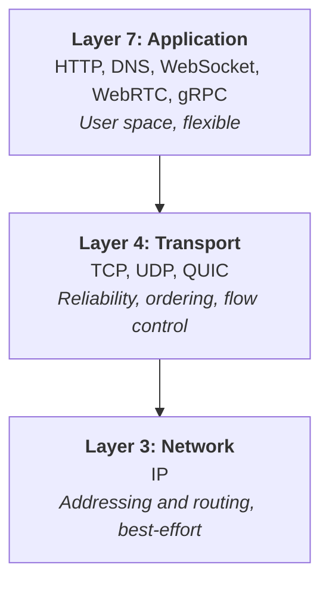

| Layer | Protocols | Job |
|---|---|---|
| **L3 Network** | IP | Addressing + routing packets across networks. Best-effort delivery. |
| **L4 Transport** | TCP, UDP, QUIC | End-to-end delivery between apps (reliability, ordering, flow control). |
| **L7 Application** | HTTP, DNS, WebSocket, WebRTC | Defines *what* the data means for web apps. |

💡 **Rule of thumb:** the higher up the stack, the more latency and processing it costs.

**IP notes**
- IPs are usually assigned by a **DHCP** server on boot.
- **Public IPs** are allocated by a RIR and are routable on the internet. Private networks can use any addressing internally.

---

## 2. What Happens in a Web Request

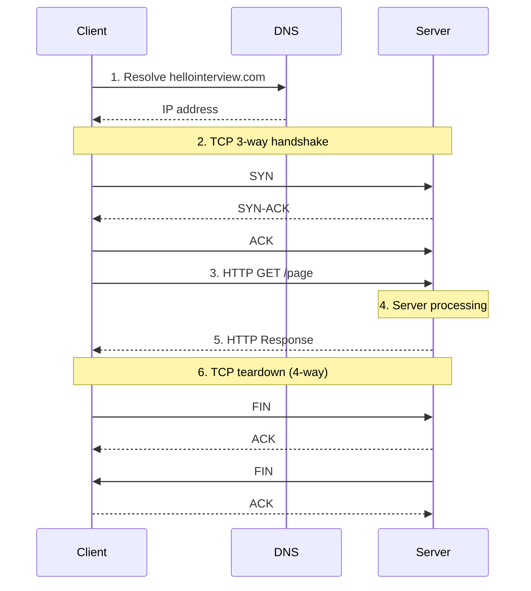

**Takeaways**
1. **Simple mental model:** the app trusts TCP for reliable, ordered delivery, DNS for lookup, and IP for routing.
2. **Many hidden round trips** = hidden latency (DNS + handshake + request).
3. **Connections are state** that both sides maintain. Without **HTTP keep-alive** or **HTTP/2 multiplexing**, setup repeats per request. This matters for persistent-connection designs (real-time).

---

## 3. Transport: TCP vs UDP

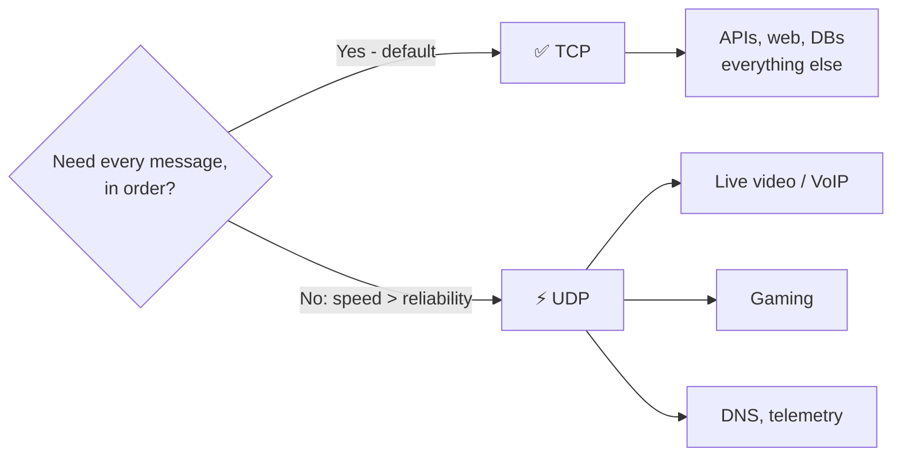

| Feature | **UDP** | **TCP** |
|---|---|---|
| Connection | Connectionless | Connection-oriented (stateful stream) |
| Reliability | Best-effort, may lose packets | Guaranteed (ACK + retransmit) |
| Ordering | None | Ordered within a stream |
| Flow control | No | Yes |
| Congestion control | No | Yes |
| Header size | 8 bytes | 20 to 60 bytes |
| Speed | Faster | Slower (overhead) |
| Use cases | Streaming, gaming, VoIP | Everything else |

- **UDP = "spray and pray".** Fast, but you handle loss yourself.
- **TCP = default.** Interviewers assume TCP unless you say otherwise.
- **QUIC** = modern, TCP-like improvements, but not yet ubiquitous. Think "better TCP, less adoption" (underpins HTTP/3).
- ⚠️ **Browsers barely support raw UDP** (except via WebRTC). If you pick UDP, say what browser clients will do instead (e.g. batched HTTP).
- Real apps mix both: video call = TCP/HTTP for signaling + UDP/WebRTC for media.

---

## 4. Application Protocols

### 4.1 HTTP / HTTPS

- **Request-response**, **stateless** (each request independent). Statelessness is good: minimize stateful surface area.
- **HTTPS = HTTP + TLS**: encrypts in transit (stops eavesdropping / MITM).
- ⚠️ **Encrypted ≠ trusted.** Never trust request body contents. Example bug: accepting `userId` from the body to query the DB lets an attacker read anyone's data. Validate on the server, derive identity from the auth token.

**Anatomy:** method · path · headers (key/value metadata) · body · status code.

**Common methods**

| Method | Use |
|---|---|
| GET | Read data (idempotent, no body) |
| POST | Send / create data |
| PUT | Update (replace) |
| PATCH | Partial update |
| DELETE | Remove (idempotent) |

**Common status codes**

| Range | Meaning | Examples |
|---|---|---|
| 2xx | ✅ Success | 200 OK · 201 Created |
| 3xx | ↪️ Redirect | 301 Moved Permanently · 302 Found |
| 4xx | 🙋 Client error | 401 Unauthorized · 403 Forbidden · 404 Not Found · 429 Too Many Requests |
| 5xx | 🔥 Server error | 500 Server Error · 502 Bad Gateway |

> Headers show flexible design: `Accept-Encoding` / `Content-Encoding` let client and server negotiate gzip or brotli, with graceful fallback.

---

### 4.2 Protocol Picker (REST / GraphQL / gRPC / SSE / WebSocket / WebRTC)

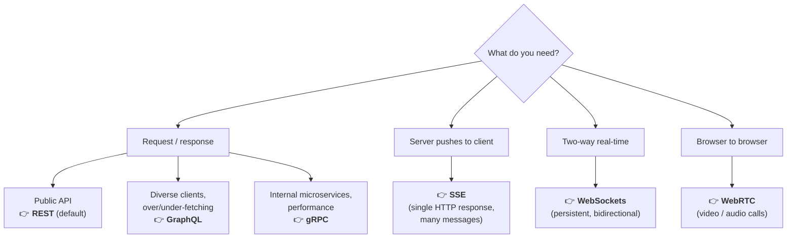

#### Quick comparison

| Protocol | Built on | Direction | Best for | Watch out |
|---|---|---|---|---|
| **REST** | HTTP + JSON | Request/response | Default for almost everything | JSON is less efficient at extreme throughput |
| **GraphQL** | HTTP, single endpoint | Request/response | Flexible clients, fast frontend iteration | Backend complexity, N+1 |
| **gRPC** | HTTP/2 + Protobuf | Req/res + streaming | Internal service-to-service | No browser support, poor for public APIs |
| **SSE** | HTTP | Server → client | Live feeds, auction price updates | Connection timeouts (auto-reconnect), proxies may batch |
| **WebSocket** | TCP (HTTP upgrade) | Bidirectional | Chat, games, collaboration | Stateful, infra support needed, expensive at scale |
| **WebRTC** | UDP, P2P | Peer ↔ peer | Video/audio calls | Complex (NAT traversal), niche |

#### SSE vs WebSocket vs HTTP

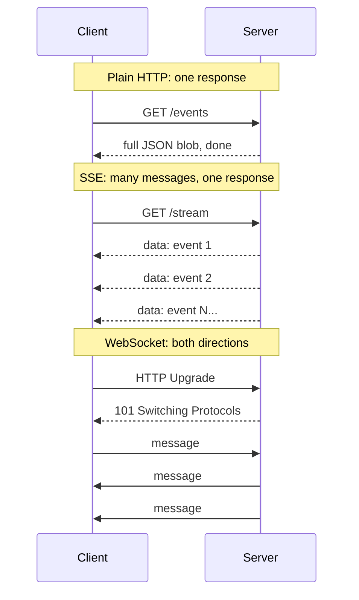

**WebSocket tips**
- Starts as an HTTP **Upgrade**, then takes over the TCP connection.
- Doesn't define an app protocol. You choose the message format (JSON is common).
- ❗ **Every hop** (firewalls, proxies, LBs) must support it.
- 🚫 Using WebSockets without justification is a classic interview red flag. If SSE or plain request/response is enough, use that.

---

### 4.3 WebRTC (Peer-to-Peer)

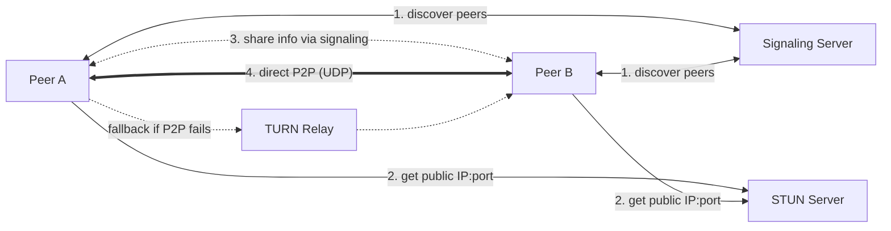

- **Signaling server:** peers find each other and exchange connection info.
- **STUN:** discover public address (NAT hole punching).
- **TURN:** relay fallback when direct connection fails.
- **Use it for:** audio/video calling and conferencing. Avoid it elsewhere (most collaborative editors use WebSockets plus a central server).

---

## 5. Load Balancing

**Scaling options:** vertical (bigger server) or horizontal (more servers). Interviews mostly use **horizontal**, so you need a way to route traffic.

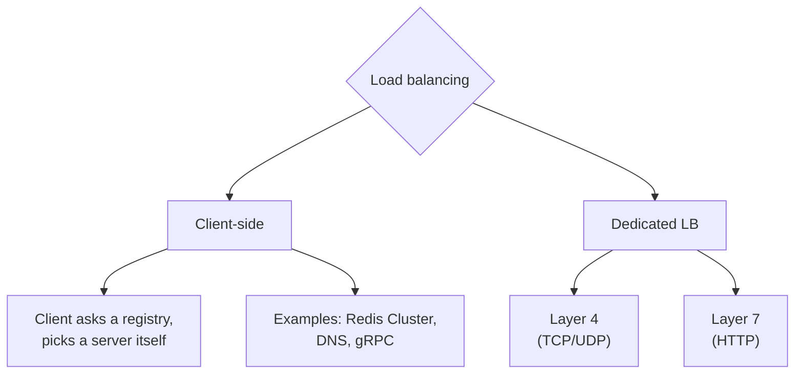

### 5.1 Client-Side Load Balancing

- Client holds a server list (from a registry / gossip / DNS) and picks one. **No extra hop.**
- **Redis Cluster:** the client hashes the key → picks a shard/node. A wrong node replies `MOVED`.
- **DNS:** returns a rotated list of IPs. Works for large client counts if slow updates are OK (limited by **TTL**). You can also run two LBs in different regions and rotate via DNS to avoid a single point of failure.
- **Best for:** a small number of clients you control (internal microservices, built into gRPC), or tolerable-stale large populations (DNS).

### 5.2 Dedicated Load Balancers (extra hop, but fast updates + control)

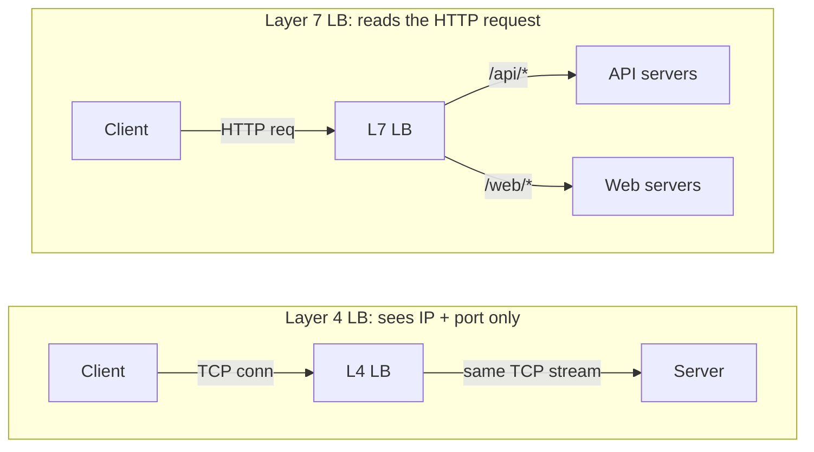

| | **Layer 4** | **Layer 7** |
|---|---|---|
| Looks at | IP + port (not content) | URL, headers, cookies, body |
| Connection | Persistent client↔server TCP | Terminates + opens new backend conns |
| Speed | Very fast | More CPU, slower |
| Flexibility | Low | High (routing, sticky sessions, API-gateway-like) |
| Best for | **WebSockets**, persistent connections, raw performance | **HTTP traffic**, long polling, content-based routing |

**Health checks:** the LB removes unhealthy servers automatically.
- L4: TCP check ("accepting connections?")
- L7: HTTP check (expects `200`, not `500`)

**Algorithms**

| Algorithm | Behaviour | Good for |
|---|---|---|
| Round Robin | Sequential | Stateless apps |
| Random | Random pick | Stateless apps |
| **Least Connections** | Fewest active conns | **WebSocket / SSE** (avoids piling up connections) |
| Least Response Time | Fastest server | Latency-sensitive |
| IP Hash | Client IP → server | Session stickiness |

**Implementations:** Hardware (F5 BIG-IP) · Software (HAProxy, NGINX, Envoy) · Cloud (AWS ALB/NLB, GCP LB, Azure LB). Hardware scales to 100s of millions of requests per second, which is a good answer if throughput is huge.

---

## 6. Latency and Regionalization

- Physics limits you: light in fiber ≈ 200,000 km/s. New York ↔ London (~5,600 km) has a theoretical round trip of ≈ **56 ms** before any processing.
- Principle: **data locality**. Keep data close to compute, and compute close to users.

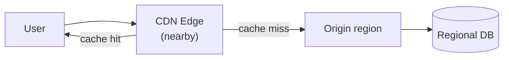

| Strategy | What | Example |
|---|---|---|
| **CDN** | Cache static/cacheable content at edge locations worldwide | Images, videos, FB post-search results |
| **Regional partitioning** | Partition data and servers by geography, co-locate compute with DB | Uber: Miami riders never need NYC drivers |

---

## 7. Failure Handling

> ⚠️ **"The network is reliable" is a fallacy.** Calls will fail, be delayed, or return unexpected results.

### 7.1 Timeouts + Retries with Exponential Backoff + Jitter

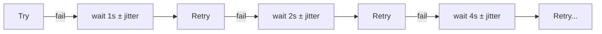

- **Backoff** = wait longer after each failure so you don't make an outage worse.
- **Jitter** = randomness, so clients don't all retry at once (avoids a synchronized "jackhammer").
- 🎯 Magic phrase: **"retry with exponential backoff (and jitter)"**.

### 7.2 Idempotency

- Retries are only safe if the operation is **idempotent** (same result no matter how many times it's called).
- GET is naturally idempotent. For writes (payments!) use an **idempotency key**: the server stores the key, so a duplicate request is processed once.

### 7.3 Circuit Breaker (stops cascading failures)

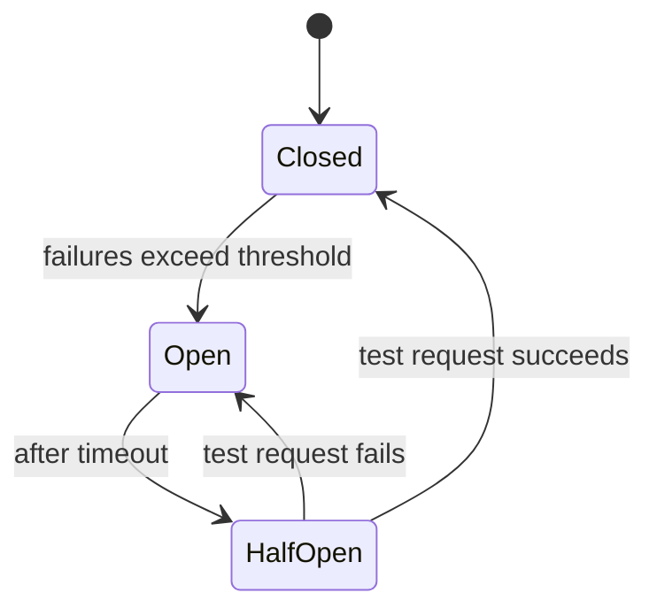

- **Closed:** normal traffic.
- **Open:** fail immediately, no call made (gives the service room to recover).
- **Half-open:** let a trial request through to test recovery.
- **Benefits:** fail fast, reduce load, self-healing, better UX (fast fallback), stability. Prevents the **thundering herd**.
- **Use on:** third-party API calls, DB connections, service-to-service calls, any slow or flaky network call.

---

# PART 2: API DESIGN

> 🎯 Most interviewers don't want a perfect API. They want a **reasonable** one in about **5 minutes**, then on to the harder parts. Over-investing here is a more common mistake than under-investing.

## 8. Choosing an API Type

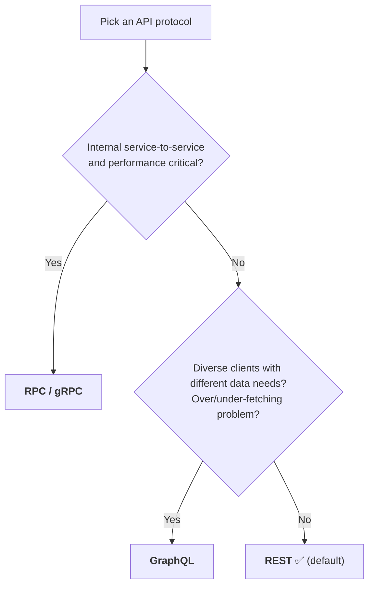

> **If unsure, say: "I'll use REST APIs"** and move on. It covers ~90% of cases.
> Real-time (notifications, chat) uses persistent connections (WebSocket/SSE), covered in the Real-time Updates pattern.

**Common hybrid:** **REST for public APIs**, **gRPC internally** between services.

---

## 9. REST Essentials

### 9.1 Resource Modeling

Core entities (from the delivery framework) → REST resources. **Resources = things (plural nouns), not actions.**

```
GET  /events                    # list events
GET  /events/{id}               # one event
GET  /venues/{id}               # one venue
GET  /events/{id}/tickets       # tickets for an event
POST /events/{id}/bookings      # create a booking
GET  /bookings/{id}             # one booking
```

| ❌ Action-style | ✅ Resource-style |
|---|---|
| `/getUserBookings` | `GET /users/{id}/bookings` |
| `/processPayment` | `POST /payments` |
| `updateUser()` | `PUT /users/{id}` |
| `startGame()` | `PATCH /games` with `{"status":"started"}` |

**Nested vs flat**

| Use | When | Example |
|---|---|---|
| **Path param / nesting** | Relationship is **required** | `/events/{id}/tickets` |
| **Query param** | Filter is **optional** | `/tickets?event_id=123&section=VIP` |

### 9.2 HTTP Methods & Idempotency

| Method | Purpose | Idempotent? | Notes |
|---|---|---|---|
| **GET** | Read | ✅ | Safe, no state change |
| **POST** | Create | ❌ | Retry = duplicates |
| **PUT** | Replace whole resource (or create) | ✅ | Send full object |
| **PATCH** | Partial update | ⚠️ Depends | "set email = X" yes, "append to list" no |
| **DELETE** | Remove | ✅ | Same end state (first call 204, later 404) |

> **Idempotent** = repeating the request leaves the server in the same final state. It matters because of client retries on network failure.

### 9.3 Where to Put Input

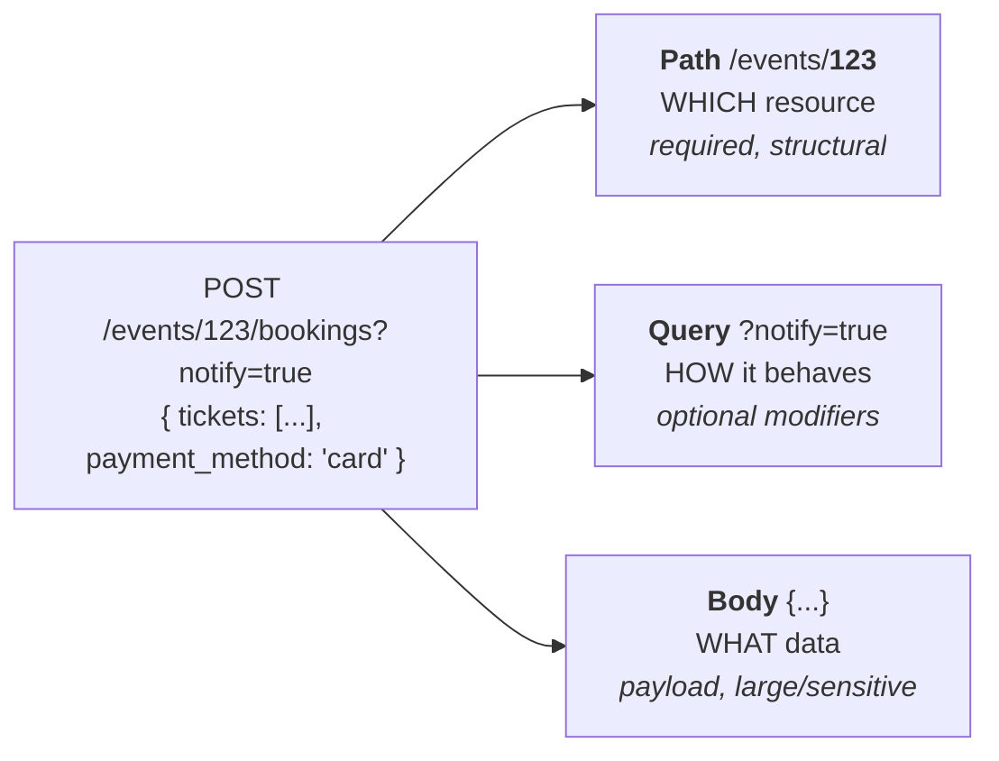

| Input | Role | Used for |
|---|---|---|
| **Path params** | Structural (identify resource) | `/events/123` |
| **Query params** | Modifiers (optional) | filter, sort, paginate: `?city=NYC&page=2&limit=20` |
| **Request body** | Payload | Complex, large, or sensitive data |

### 9.4 Returning Data

- **Status code** + **JSON body**.
- Stick to: `200` OK · `201` Created · `400` Bad request · `401` Auth required · `404` Not found · `500` Server error.
- Know **4xx = client's fault**, **5xx = server's fault**. Using `4xx`/`5xx` placeholders is fine in interviews.

---

## 10. GraphQL

**Origin:** Facebook, to stop mobile and web being stuck with fixed REST payloads. **One endpoint**, and the **client specifies the response shape**.

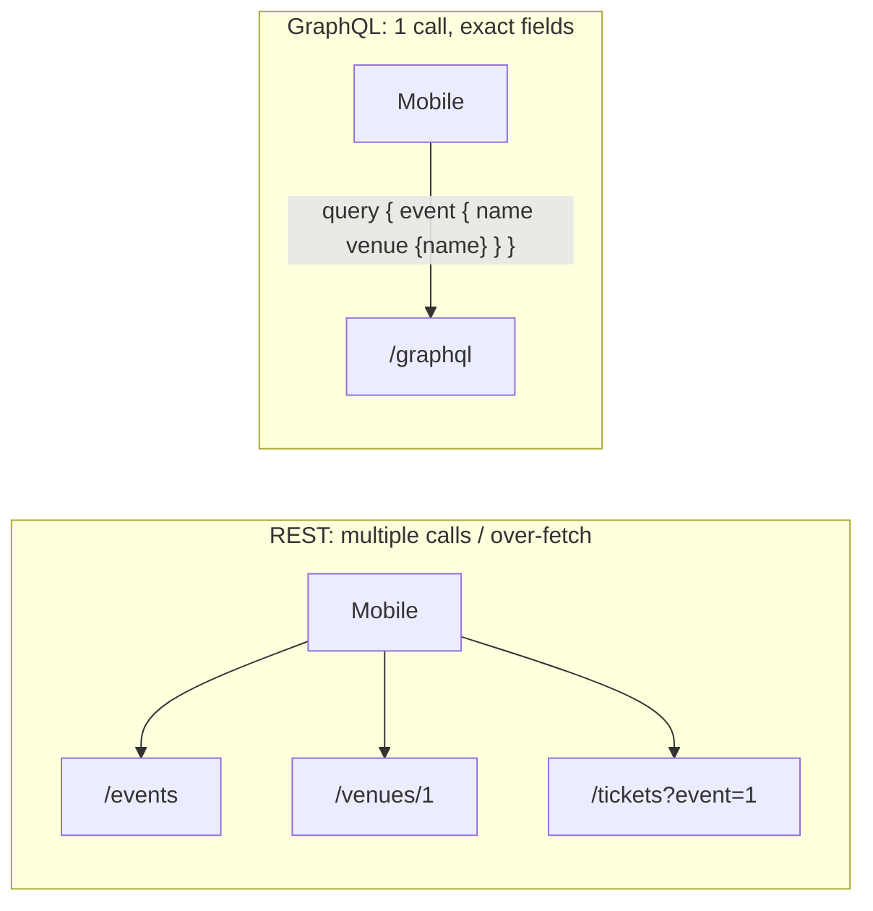

```graphql
query {
  event(id: "123") {
    name
    date
    venue { name address }
    tickets { section price available }
  }
}
```

**Schema example**
```graphql
type Event { id: ID!  name: String!  date: DateTime!  venue: Venue!  tickets: [Ticket!]! }
type Query { event(id: ID!): Event   events(limit: Int, after: String): [Event!]! }
```

| ✅ Use when | ⚠️ Costs |
|---|---|
| Diverse clients (mobile vs web) | Query parsing, schema validation, complex caching |
| Frontend iterates without backend changes | **N+1 problem** (1 query for events + N for venues → fix with batching / DataLoader) |
| Interviewer mentions over/under-fetching | Authorization is **per field**, not per endpoint |

**Interview tip:** only bring it up when there's a clear flexibility or fetching problem. Don't default to it.

---

## 11. RPC / gRPC

**Action-oriented** (call functions across the network) vs REST's resource-oriented style.

```
getEvent(eventId: "123")                          // instead of GET /events/123
createBooking(eventId, userId, tickets)           // instead of POST /events/123/bookings
getAvailableTickets(eventId, section: "VIP")      // instead of GET /events/123/tickets
```

**gRPC** = **HTTP/2 + Protocol Buffers** (binary, schema-defined).

```protobuf
service TicketService {
  rpc GetEvent(GetEventRequest) returns (Event);
  rpc CreateBooking(CreateBookingRequest) returns (Booking);
}
message Event { string id = 1; string name = 2; int64 date = 3; Venue venue = 4; }
```

- One `.proto` file generates client + server code in many languages, with **compile-time type safety**.
- Protobuf is much smaller than JSON (the source's example: 15 bytes vs 40 bytes).

**Use when:** performance critical · internal service-to-service · polyglot services · streaming needed.
**Avoid for:** public/browser-facing APIs (binary, weaker tooling, no browser support).

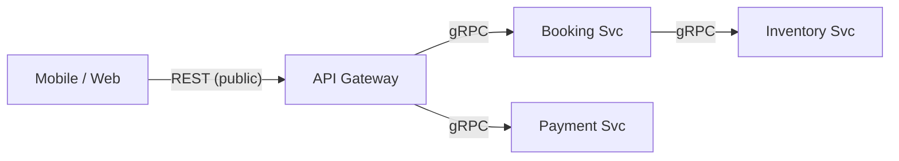

> In interviews you usually only define **user-facing APIs**. Just mention "internal services talk over RPC" in the high-level design.

---

## 12. Nine API Design Principles

| # | Principle | In one line |
|---|---|---|
| 1 | **Resources, not actions** | Expose things; let HTTP methods be the verbs. |
| 2 | **Be consistent** | Same names and shapes everywhere (`?status=` not `?state=` in some places). |
| 3 | **Least surprise** | GET never mutates, DELETE deletes, 200 means success. |
| 4 | **Stateless** | Every request carries all it needs (token, params, payload), so any server can handle it. |
| 5 | **Safe retries** | Idempotent design + idempotency keys for POST. |
| 6 | **Paginate anything that grows** | Plus cap page size (no `?limit=100000`). |
| 7 | **Secure by default** | Auth on every endpoint unless explicitly public, plus authorization and rate limiting. |
| 8 | **Evolve without breaking** | Adding fields is safe; renaming/removing is breaking, so version it. |
| 9 | **Actionable errors** | Right status class + machine-readable code + human message. |

💬 **Apply them out loud:** *"I'll use an idempotency key so a retry can't double-book the seat."* This beats reciting principles.

---

## 13. Common API Patterns

### 13.1 Pagination

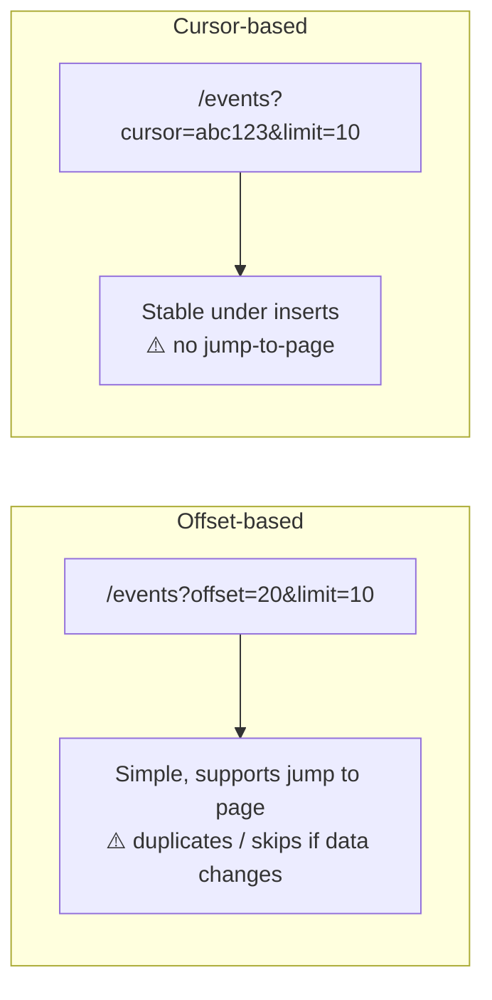

| | Offset | Cursor |
|---|---|---|
| Simplicity | ✅ Easy | More work |
| Stable under changes | ❌ | ✅ |
| Jump to page N | ✅ | ❌ |
| Interview default | ✅ usually fine | Use for real-time / high-volume |

Cursor response shape: `{ "events": [...], "next_cursor": "<id of last item>" }`

### 13.2 Filtering & Sorting

```
/events?city=NYC&status=upcoming     # filter
/events?sort=date                    # ascending
/events?sort=-date                   # descending (leading minus)
```
Keep param names **consistent across endpoints**. One filtered example is enough in an interview.

### 13.3 Idempotency Keys

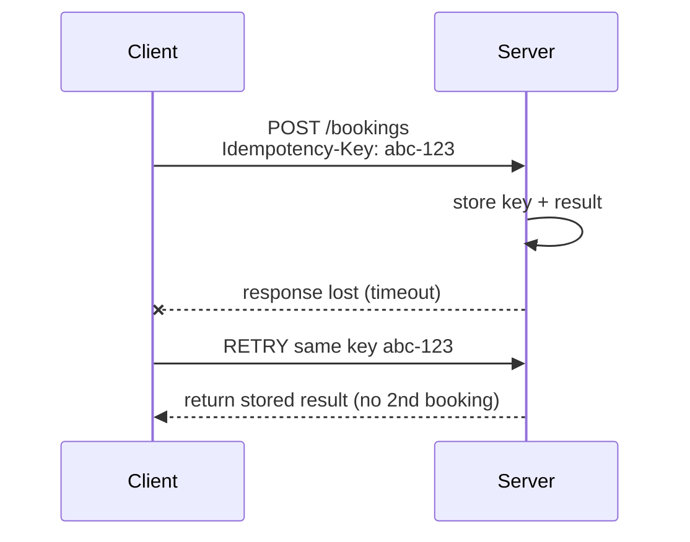

- Client generates a unique key per logical operation → server stores key + first result → duplicates return the stored response.
- Stripe uses this for payments. **Mention it for payments, bookings, orders.**

### 13.4 Consistent Error Envelope

```json
{
  "error": {
    "code": "SEAT_UNAVAILABLE",
    "message": "Section VIP has only 1 seat remaining"
  }
}
```
`code` is stable and machine-readable (clients branch on it); `message` is for humans and can change.

### 13.5 Versioning

| Strategy | Example | Pros | Cons |
|---|---|---|---|
| **URL** (preferred in interviews) | `/v1/events`, `/v2/events` | Explicit, simple routing | URL changes |
| **Header** | `Accept-Version: v2` | Clean URLs | Less visible, harder to test in browser |

---

## 14. Security

### Authentication vs Authorization

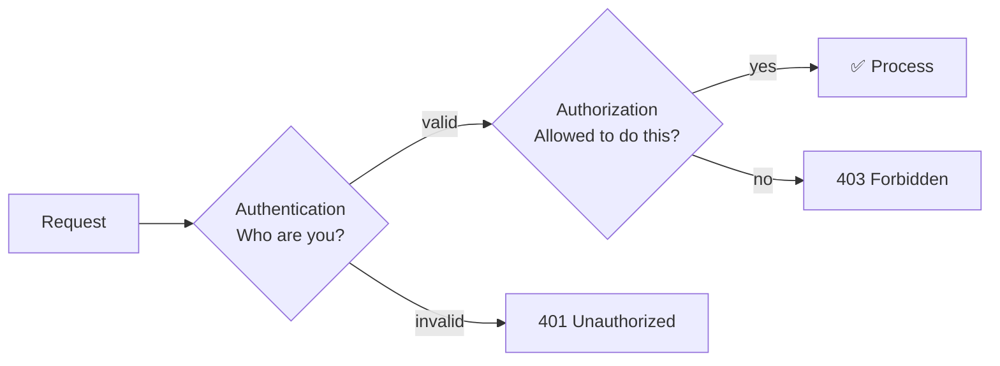

### API Keys vs JWT

| | **API Key** | **JWT** |
|---|---|---|
| What | Long random string, like a password for an *app* | Signed token carrying user info + expiry |
| State | Looked up in DB | **Stateless** (verify signature) |
| Best for | Server-to-server, third-party developers | **User sessions** (web / mobile) |
| Avoid for | User-facing products | N/A |
| Example | `Authorization: Bearer sk_live_...` | Payload: `{user_id, role, exp}` |

> Interview shortcut: say which endpoints need auth and that you'd use **JWT** (or session in a DB).

### RBAC (Role-Based Access Control)

```
customer       → book tickets, view OWN bookings
venue_manager  → create events, view sales for THEIR venues
admin          → everything
```
`GET /bookings/{id}` → ① authenticated? ② owns the booking **or** admin?

### Rate Limiting

| Type | Example |
|---|---|
| Per user | 1000 req/hour |
| Per IP | 100 req/hour (unauthenticated) |
| Per endpoint | 10 booking attempts/min |

Implemented at the **API gateway** or middleware → return **`429 Too Many Requests`**. In interviews, "we'll rate limit to prevent abuse" is enough.

---

# 15. Interview Cheat Sheet

## ⚡ Defaults

| Decision | Default | Switch when... |
|---|---|---|
| Transport | **TCP** | Latency > reliability (live media, gaming) → UDP |
| API style | **REST** | Flexible clients → GraphQL · Internal perf → gRPC |
| Server push | n/a | One-way → **SSE** · Two-way → **WebSocket** |
| Peer-to-peer | n/a | Video/audio calls only → **WebRTC** |
| Load balancer | **L7** | WebSockets / persistent conns → **L4** |
| LB algorithm | Round robin / random | Persistent conns → **Least connections** |
| Pagination | **Offset** | Real-time / huge data → **Cursor** |
| Versioning | **URL** (`/v1/`) | Rarely asked |
| User auth | **JWT** | Server-to-server → API key |
| Retries | **Exponential backoff + jitter** | + idempotency keys on writes |
| Cascading failures | **Circuit breaker** | n/a |
| Global latency | **CDN** + regional partitioning | n/a |

## 🧠 Phrases Interviewers Love

- "I'll use **REST** with resources as plural nouns."
- "**Retry with exponential backoff and jitter**, with an **idempotency key** on the POST."
- "**L4 load balancer** for the persistent WebSocket connections, with **least connections** routing."
- "**gRPC** internally, **REST** externally."
- "A **circuit breaker** around the payment provider prevents cascading failures."
- "**Cursor-based pagination** since the feed changes in real time."
- "A **CDN** at the edge for cacheable content to cut latency and origin load."

## 🚫 Common Mistakes

- ❌ Reaching for **WebSockets** without justification (SSE or request/response often suffices).
- ❌ Spending **more than ~5 minutes** on API design.
- ❌ **Action-based endpoints** (`/getUser`, `/processPayment`).
- ❌ **Trusting user IDs in the request body.**
- ❌ **Retrying non-idempotent** requests without idempotency keys.
- ❌ Defaulting to **GraphQL** or **WebRTC** when the problem doesn't call for them.
- ❌ Hyper-optimizing the RPC protocol before solving real bottlenecks.
- ❌ Unpaginated list endpoints.

## 🔁 Self-Quiz (cover the answers!)

1. Why is TCP the default over UDP, and when would you choose UDP?
2. What are the 3 steps of a TCP handshake?
3. L4 vs L7 load balancer: which for WebSockets, and why?
4. Which LB algorithm suits persistent connections?
5. What's the difference between STUN and TURN?
6. What are the three states of a circuit breaker?
7. Why add jitter to backoff?
8. Which HTTP methods are idempotent?
9. Path param vs query param: when to use which?
10. What is the N+1 problem in GraphQL?
11. Offset vs cursor pagination: trade-offs?
12. How does an idempotency key prevent a double charge?
13. API key vs JWT: when to use which?
14. Why can't the browser talk gRPC directly?

<details>
<summary>Show answers</summary>

1. TCP gives reliability, ordering, flow and congestion control. Choose UDP when speed beats reliability and some loss is OK (live video, gaming, VoIP, telemetry), and you have an alternative for browsers.
2. SYN → SYN-ACK → ACK.
3. L4, because it keeps one persistent TCP connection to the same server without inspecting content.
4. Least connections.
5. STUN discovers your public address (NAT hole punching). TURN relays traffic when a direct connection fails.
6. Closed, Open, Half-open.
7. So clients don't all retry at the same moment (synchronized retry storms).
8. GET, PUT, DELETE (POST is not; PATCH depends).
9. Path = required, identifies the resource. Query = optional filters, sorting, pagination.
10. One query for N items plus N follow-up queries for related data. Fix with batching (DataLoader).
11. Offset: simple and supports jumping to a page, but can skip or duplicate on changing data. Cursor: stable, but no jump-to-page.
12. The server stores the key with the first result, and returns that stored result for retries instead of re-processing.
13. API key for server-to-server and third-party developers. JWT for user sessions.
14. gRPC uses a binary protocol over HTTP/2 features that browsers don't expose natively, and browser support is limited.

</details>

---

## 🔗 References

- [Networking Essentials, Hello Interview](https://www.hellointerview.com/learn/system-design/core-concepts/networking-essentials)
- [API Design, Hello Interview](https://www.hellointerview.com/learn/system-design/core-concepts/api-design)
- Hands-on practice: capture traffic with **Wireshark**, and simulate bad networks with **Network Link Conditioner**.